# 1.为什么程序启动后可以通过浏览器访问？

因为执行：

```
fastapi dev main.py
```

后，不只是运行了一次 Python 文件，还启动了一个持续运行的 **HTTP Web 服务器**。

完整过程是：

```
浏览器
  │ GET http://127.0.0.1:8000/
  ▼
Uvicorn Web 服务器
  │ 把请求交给 FastAPI
  ▼
FastAPI 匹配 @app.get("/")
  │ 调用 read_root()
  ▼
返回 Python 字典
  │ 转换成 JSON/HTTP 响应
  ▼
浏览器显示结果
```

## Uvicorn是什么

Uvicorn 是一个用于运行 Python Web 应用的 **Web 服务器**。它负责接收浏览器发来的网络请求，再把请求交给 FastAPI 处理。

可以这样理解：

```
浏览器 → Uvicorn → FastAPI → 你的函数
浏览器 ← Uvicorn ← FastAPI ← 返回结果
```

它们的分工不同：

| 组件     | 作用                                           |
| -------- | ---------------------------------------------- |
| Uvicorn  | 监听 IP 和端口、接收 HTTP 请求、发送 HTTP 响应 |
| FastAPI  | 匹配路由、校验数据、调用对应的 Python 函数     |
| 你的代码 | 执行业务逻辑并返回结果                         |

例如浏览器访问：

```
http://127.0.0.1:8000/
```

执行过程是：

1. Uvicorn 在 `127.0.0.1:8000` 等待请求。

2. 浏览器向 Uvicorn 发送 `GET /` 请求。

3. Uvicorn 将请求交给 FastAPI。

4. FastAPI 找到：

   ```
   @app.get("/")
   def read_root():
       return {"message": "Hello, World!"}
   ```

5. FastAPI 执行 `read_root()`。

6. Uvicorn 把返回结果通过 HTTP 发回浏览器。

### FastAPI 为什么还需要 Uvicorn？

FastAPI 是 Web 框架，主要负责描述“收到什么请求后应该执行什么代码”，但它本身不直接负责底层网络通信。

Uvicorn 负责：

- 监听 `8000` 端口
- 接收浏览器连接
- 解析 HTTP 请求
- 把请求传递给 FastAPI
- 把 FastAPI 的结果发送给浏览器
- 同时处理多个请求

FastAPI 与 Uvicorn 之间使用一种叫做 **ASGI** 的标准进行通信。初学阶段可以简单理解为：ASGI 是 Web 服务器和 Python Web 应用之间约定的接口。

当你运行：

```
fastapi dev main.py
```

FastAPI CLI 会在后台帮你启动 Uvicorn。大致相当于：

```
uvicorn main:app --reload
```

其中：

- `main`：`main.py`
- `app`：文件中的 `app = FastAPI()`
- `--reload`：代码保存后自动重新启动服务器

可以把 Uvicorn 看成“接待员”，FastAPI 是“业务处理人员”：接待员负责收发请求，FastAPI 决定具体如何处理。

你的代码是：

```
@app.get("/")
def read_root():
    return {"message": "Hello, World!"}
```

当浏览器访问：

```
http://127.0.0.1:8000/
```

这个地址可以拆解为：

- `http://`：使用 HTTP 协议
- `127.0.0.1`：当前电脑，也称 localhost
- `8000`：FastAPI 服务器监听的端口
- `/`：请求的路径

浏览器会发送类似这样的请求：

```
GET / HTTP/1.1
Host: 127.0.0.1:8000
```

FastAPI 看到这是一个访问 `/` 的 GET 请求，于是匹配：

```
@app.get("/")
```

然后执行：

```
read_root()
```

返回的 Python 字典：

```
{"message": "Hello, World!"}
```

会被 FastAPI 自动转换成 JSON 响应：

```
{"message": "Hello, World!"}
```

浏览器收到后就把它显示出来。

需要注意，`127.0.0.1` 只能从你自己的电脑访问，并没有公开到互联网。按 `Ctrl + C` 停止服务器后，再刷新浏览器就会无法访问，因为已经没有程序监听 `8000` 端口了。

# 2.路由

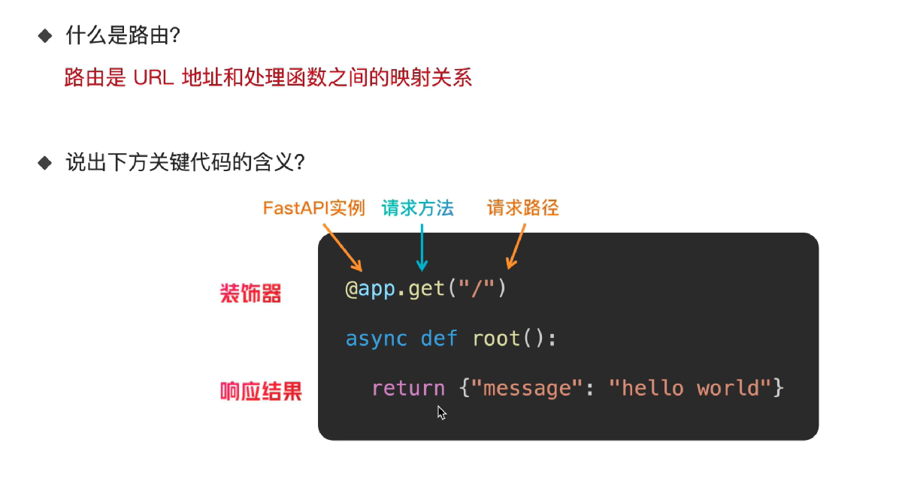

# 3.客户端、服务器、请求、响应、JSON、HTTP 状态码的基本概念

可以把一次互联网访问想象成“顾客去餐厅点餐”：

- 客户端：顾客
- 服务器：餐厅
- 请求：顾客提交的订单
- 响应：餐厅返回的菜品或处理结果
- JSON：订单和结果采用的一种标准书写格式
- HTTP 状态码：表示订单是否成功受理的标准编号

下面分别解释。

## 1. 客户端 Client

客户端是主动发起请求的一方。

常见客户端包括：

- Chrome、Edge 等浏览器
- 手机 App
- 微信小程序
- 网页中的 JavaScript 程序
- Postman、curl 等接口测试工具
- 另一个服务器程序

例如，在浏览器地址栏输入：

```
https://example.com/products/1001
```

浏览器会向 `example.com` 的服务器发送请求。此时浏览器就是客户端。

客户端通常负责：

- 收集用户输入
- 向服务器发送请求
- 接收服务器响应
- 展示页面或数据
- 在本地执行部分业务逻辑
- 保存 Cookie、Token 等身份信息

需要注意，“客户端”和“前端”经常相关，但不完全相同：

- 前端通常指用户直接看到和操作的界面代码。
- 客户端是一个更宽泛的概念，只要主动调用服务器，就可以称为客户端。

例如，一个后端服务器调用天气服务时，它对于天气服务来说也是客户端。

------

## 2. 服务器 Server

服务器是接收请求、处理请求并返回响应的一方。

服务器既可以指：

1. 一台物理计算机或云主机；
2. 运行在计算机上的服务程序；
3. 整套后端系统。

在实际开发中，人们说“服务器返回了错误”，通常是在说后端服务程序返回了错误。

服务器可能执行以下工作：

- 验证用户身份
- 检查请求参数
- 执行业务逻辑
- 查询或修改数据库
- 访问其他服务器
- 生成网页或 JSON 数据
- 返回处理结果

例如，客户端请求商品信息：

```
GET /products/1001
```

服务器可能：

1. 读取商品编号 `1001`；
2. 查询数据库；
3. 找到对应商品；
4. 把商品信息转换为 JSON；
5. 返回给客户端。

服务器不一定只有一台。在大型系统里，一次请求可能经过：

```
浏览器
  → 网关服务器
  → 用户服务
  → 商品服务
  → 数据库
```

不过对于客户端来说，这些内部细节通常是透明的。

------

## 3. 请求 Request

请求是客户端发送给服务器的一条消息，用来表达：

> 我希望你对某个资源执行某个操作。

一个 HTTP 请求通常由以下部分组成。

### 3.1 请求方法

请求方法说明客户端希望执行什么操作。

常见方法：

| 方法     | 常见含义           | 示例             |
| -------- | ------------------ | ---------------- |
| `GET`    | 获取数据           | 查询商品         |
| `POST`   | 创建数据或提交操作 | 创建订单         |
| `PUT`    | 整体替换数据       | 替换完整用户资料 |
| `PATCH`  | 修改部分数据       | 只修改用户昵称   |
| `DELETE` | 删除数据           | 删除评论         |

例如：

```
GET /api/products/1001
```

表示获取编号为 `1001` 的商品。

```
DELETE /api/products/1001
```

表示请求删除这个商品。

方法表达的是语义，但服务器仍然需要通过权限检查决定是否允许操作。发送 `DELETE` 并不意味着一定能删除成功。

### 3.2 URL

URL 用来指定访问位置。

例如：

```
https://api.example.com/products/1001?currency=CNY
```

可以拆分为：

```
https                   协议
api.example.com         域名
/products/1001          路径
currency=CNY            查询参数
```

查询参数通常放在 `?` 后面，多个参数使用 `&` 分隔：

```
/products?page=2&page_size=20&category=book
```

### 3.3 请求头 Headers

请求头提供请求的附加信息。

例如：

```
Content-Type: application/json
Authorization: Bearer abc123
Accept: application/json
```

含义分别是：

- `Content-Type`：请求体采用什么格式。
- `Authorization`：身份认证信息。
- `Accept`：客户端希望服务器返回什么格式。

请求头一般用于描述请求，而不是承载主要业务数据。

### 3.4 请求体 Body

请求体用于传递主要数据，常见于 `POST`、`PUT` 和 `PATCH` 请求。

例如，创建用户时可能发送：

```
{
  "username": "alice",
  "email": "alice@example.com",
  "age": 20
}
```

这段 JSON 就是请求体。

`GET` 请求通常不使用请求体，而是使用路径参数或查询参数传递条件。

### 一个完整请求示例

```
POST /api/users HTTP/1.1
Host: example.com
Content-Type: application/json
Authorization: Bearer abc123

{
  "username": "alice",
  "age": 20
}
```

它表示：

- 使用 `POST` 方法；
- 请求 `/api/users`；
- 请求体是 JSON；
- 携带身份认证信息；
- 希望创建一个用户。

------

## 4. 响应 Response

响应是服务器处理请求后返回给客户端的消息。

响应通常包含：

- HTTP 状态码
- 响应头
- 响应体

例如：

```
HTTP/1.1 201 Created
Content-Type: application/json

{
  "id": 1001,
  "username": "alice",
  "age": 20
}
```

这里：

- `201` 表示成功创建了资源；
- `Content-Type` 表示响应体是 JSON；
- 响应体包含新用户的信息。

### 响应头

常见响应头包括：

```
Content-Type: application/json
Cache-Control: no-cache
Set-Cookie: session_id=abc123
```

它们可能表示：

- 响应数据的格式；
- 浏览器是否可以缓存；
- 是否需要保存 Cookie；
- 跨域访问规则；
- 响应内容长度。

### 响应体

响应体是服务器真正返回的数据，可以是：

- JSON
- HTML 页面
- 图片
- PDF
- 视频
- 文件
- 纯文本
- 空内容

浏览网页时，服务器可能返回 HTML：

```
<h1>欢迎访问</h1>
```

调用后端 API 时，服务器更常返回 JSON：

```
{
  "success": true,
  "data": {
    "id": 1001,
    "name": "键盘"
  }
}
```

------

## 5. JSON

JSON 全称为 JavaScript Object Notation，是一种用于表示结构化数据的文本格式。

虽然 JSON 来源于 JavaScript，但它并不只属于 JavaScript。Python、Java、Go、C# 等语言都可以解析和生成 JSON。

### 5.1 JSON 对象

对象使用 `{}`，内部由键值对组成：

```
{
  "name": "Alice",
  "age": 20,
  "is_student": true
}
```

其中：

- `"name"` 是键；
- `"Alice"` 是值；
- 键和值之间使用 `:`；
- 多个键值对之间使用 `,`。

### 5.2 JSON 数组

数组使用 `[]`：

```
[
  "苹果",
  "香蕉",
  "橙子"
]
```

数组也可以包含对象：

```
[
  {
    "id": 1,
    "name": "苹果"
  },
  {
    "id": 2,
    "name": "香蕉"
  }
]
```

### 5.3 JSON 支持的数据类型

JSON 支持：

- 字符串
- 数字
- 布尔值
- `null`
- 对象
- 数组

例如：

```
{
  "name": "Alice",
  "age": 20,
  "height": 1.68,
  "enabled": true,
  "address": null,
  "skills": ["Python", "JavaScript"],
  "profile": {
    "city": "Shanghai"
  }
}
```

### 5.4 JSON 的语法注意事项

JSON 的键和字符串必须使用双引号：

```
{
  "name": "Alice"
}
```

下面不是合法 JSON：

```
{
  name: 'Alice'
}
```

JSON 最后一项后面通常不能有逗号：

```
{
  "name": "Alice",
  "age": 20
}
```

下面通常会解析失败：

```
{
  "name": "Alice",
  "age": 20,
}
```

JSON 不能直接表示：

- 函数
- 注释
- 日期类型
- `undefined`
- 二进制数据

日期通常使用字符串表示：

```
{
  "created_at": "2026-10-19T10:30:00+08:00"
}
```

### 5.5 JSON 是文本，不是编程对象本身

服务器通过网络发送的是 JSON 文本：

```
{"name":"Alice","age":20}
```

客户端收到以后，需要把它解析成自己编程语言中的数据结构。例如：

- JavaScript 中解析成对象；
- Python 中解析成字典；
- Java 中转换为 Java 对象。

反过来，把程序对象转换成 JSON 文本称为序列化。

------

## 6. HTTP 状态码

HTTP 状态码是服务器用来说明请求处理结果的三位数字。

第一位数字表示大类：

| 范围  | 含义                 |
| ----- | -------------------- |
| `1xx` | 请求正在处理中       |
| `2xx` | 请求成功             |
| `3xx` | 重定向或缓存相关     |
| `4xx` | 客户端请求存在问题   |
| `5xx` | 服务器处理时出现问题 |

### 6.1 常见的 2xx

#### `200 OK`

请求成功。

```
HTTP/1.1 200 OK
```

常用于：

- 成功获取数据；
- 成功修改数据；
- 普通操作成功。

#### `201 Created`

成功创建了新资源。

例如成功创建用户：

```
HTTP/1.1 201 Created
```

#### `204 No Content`

请求成功，但响应体为空。

常用于：

- 删除成功；
- 修改成功但不需要返回数据。

------

### 6.2 常见的 3xx

#### `301 Moved Permanently`

资源永久移动到了新地址。

#### `302 Found`

资源暂时位于另一个地址。

#### `304 Not Modified`

资源没有发生变化，客户端可以继续使用缓存。

`304` 并不表示普通意义上的失败，而是服务器告诉浏览器：

> 你本地缓存的版本仍然有效，不需要重新下载。

------

### 6.3 常见的 4xx

#### `400 Bad Request`

请求格式或参数有问题。

例如：

```
{
  "error": "age 必须是数字"
}
```

可能原因：

- JSON 格式错误；
- 缺少必要参数；
- 参数类型不正确；
- 参数不符合业务规则。

#### `401 Unauthorized`

通常表示没有通过身份认证。

例如：

- 没有登录；
- Token 缺失；
- Token 已过期；
- Token 无效。

虽然英文是 `Unauthorized`，但它在实践中主要表示“未认证”。

#### `403 Forbidden`

服务器知道用户是谁，但用户没有权限执行操作。

可以这样区分：

```
401：我不知道你是谁，或者你的登录凭证无效
403：我知道你是谁，但你不能执行这个操作
```

#### `404 Not Found`

请求的资源不存在。

例如：

- URL 路径不存在；
- 查询的用户不存在；
- 文件不存在。

#### `405 Method Not Allowed`

请求方法不允许。

例如接口只支持：

```
GET /api/users
```

客户端却发送了：

```
DELETE /api/users
```

#### `409 Conflict`

请求与当前资源状态发生冲突。

例如：

- 注册时用户名已经存在；
- 重复创建同一个资源；
- 数据版本发生冲突。

#### `422 Unprocessable Content`

请求格式可以被解析，但内容没有通过数据校验。

例如：

```
{
  "email": "这不是邮箱"
}
```

很多 API 框架会用 `422` 表示参数校验失败。

#### `429 Too Many Requests`

客户端请求过于频繁，触发限流。

------

### 6.4 常见的 5xx

#### `500 Internal Server Error`

服务器内部发生了未预期错误。

例如：

- 程序异常；
- 空指针错误；
- SQL 执行失败；
- 代码中出现未处理的异常。

#### `502 Bad Gateway`

网关从上游服务器收到了无效响应。

常见过程：

```
客户端 → 网关 → 后端服务
```

如果网关能够工作，但后端服务异常，可能返回 `502`。

#### `503 Service Unavailable`

服务器暂时无法提供服务。

可能原因：

- 服务维护；
- 服务器过载；
- 后端服务尚未启动。

#### `504 Gateway Timeout`

网关等待上游服务器响应超时。

------

## 7. 状态码和业务结果不是完全相同的东西

HTTP 状态码描述的是 HTTP 层面的处理结果，而业务结果通常在响应体中表达。

例如，下面这个响应在 HTTP 层面是成功的：

```
HTTP/1.1 200 OK
Content-Type: application/json

{
  "success": false,
  "message": "账户余额不足"
}
```

它表示：

- HTTP 请求成功到达并被正常处理；
- 但具体业务操作没有成功。

另一种 API 设计可能返回：

```
HTTP/1.1 409 Conflict
Content-Type: application/json

{
  "code": "INSUFFICIENT_BALANCE",
  "message": "账户余额不足"
}
```

因此客户端通常需要同时检查：

1. HTTP 状态码；
2. 响应体中的业务状态或错误码。

不能只看到 `200` 就认为所有业务都成功，也不能只解析 JSON 而完全忽略 HTTP 状态码。

------

## 8. 一次完整交互示例

假设用户在网页上提交登录表单。

客户端发送：

```
POST /api/login HTTP/1.1
Host: example.com
Content-Type: application/json

{
  "username": "alice",
  "password": "123456"
}
```

服务器收到后：

1. 解析请求中的 JSON；
2. 检查用户名和密码；
3. 查询数据库；
4. 验证密码；
5. 创建登录凭证；
6. 返回响应。

登录成功：

```
HTTP/1.1 200 OK
Content-Type: application/json

{
  "user": {
    "id": 1001,
    "username": "alice"
  },
  "access_token": "abc123"
}
```

密码错误：

```
HTTP/1.1 401 Unauthorized
Content-Type: application/json

{
  "code": "INVALID_CREDENTIALS",
  "message": "用户名或密码错误"
}
```

服务器异常：

```
HTTP/1.1 500 Internal Server Error
Content-Type: application/json

{
  "code": "INTERNAL_ERROR",
  "message": "服务器暂时无法处理请求"
}
```

整个过程可以概括为：

```
用户操作
   ↓
客户端构造 HTTP 请求
   ↓
通过网络发送给服务器
   ↓
服务器解析请求并执行业务逻辑
   ↓
服务器生成 HTTP 响应
   ↓
客户端读取状态码和响应体
   ↓
向用户展示结果
```

## 9. 六个概念之间的关系

一句话总结：

> 客户端通过 HTTP 请求向服务器表达操作意图，服务器处理后通过 HTTP 响应返回结果；请求体和响应体经常使用 JSON 表示数据，HTTP 状态码则说明请求的总体处理状态。

一个简单 API 调用中，各部分对应如下：

```
POST /api/orders HTTP/1.1             ← 请求方法和地址
Content-Type: application/json        ← 请求头

{
  "product_id": 1001,
  "quantity": 2
}                                      ← JSON 请求体
```

服务器返回：

```
HTTP/1.1 201 Created                   ← HTTP 状态码
Content-Type: application/json         ← 响应头

{
  "order_id": 9001,
  "status": "created"
}                                      ← JSON 响应体
```

这里客户端负责发送订单，服务器负责创建订单，HTTP 规定双方如何交换消息，JSON规定数据如何书写，状态码则概括处理结果。

# 4.路径参数和查询参数

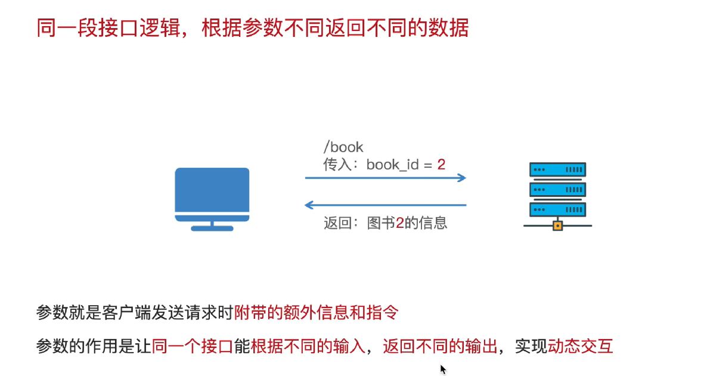

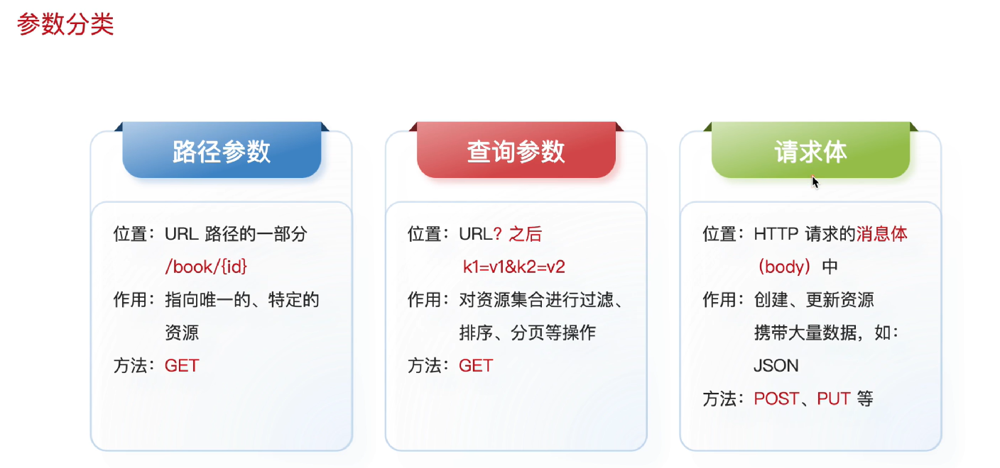


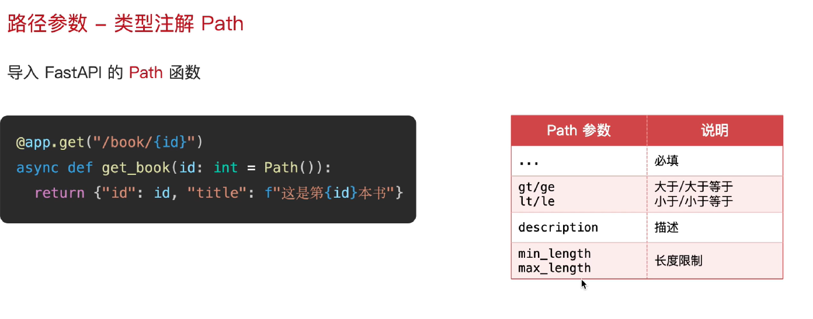

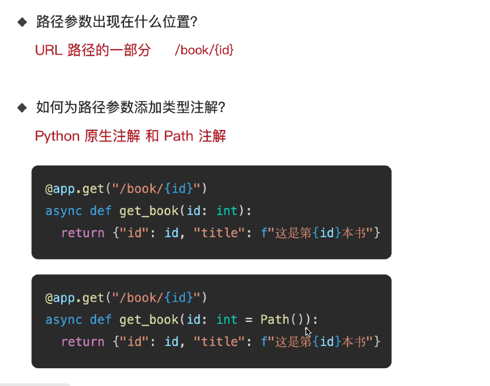

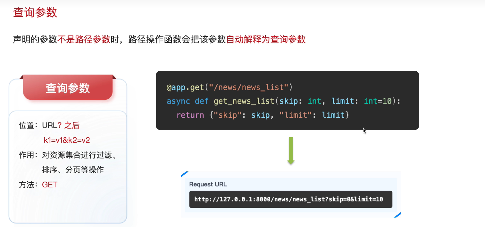

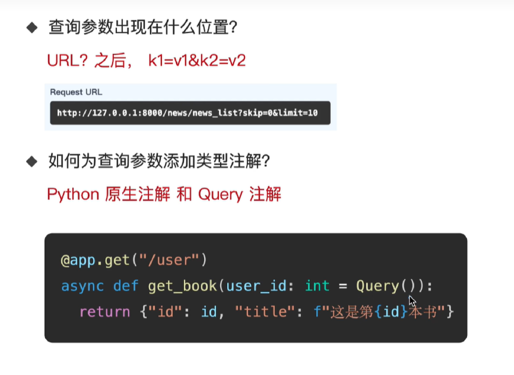

## /tasks/1 与 /tasks?status=pending 的区别是什么？task_id: int 为什么可以进行参数校验？

假设这两个地址都用于 `GET` 请求：`/tasks/1` 通常表示“获取编号为 1 的任务”，`/tasks?status=pending` 通常表示“查询所有待处理的任务”。

而 `task_id: int` 能在 FastAPI 中触发校验，是因为 **FastAPI 会读取这个类型注解，并使用 Pydantic 解析、校验请求参数**。Python 本身不会仅凭这个注解自动检查传入的值。

先看两个地址的区别：

| 对比项       | `/tasks/1`           | `/tasks?status=pending`     |
| ------------ | -------------------- | --------------------------- |
| URL 路径     | `/tasks/1`           | `/tasks`                    |
| 参数类别     | 路径参数             | 查询参数                    |
| 参数值       | `task_id` 的值为 `1` | `status` 的值为 `"pending"` |
| 常见用途     | 指定某一条任务       | 指定任务列表的筛选条件      |
| 常见返回结果 | 一个任务对象         | 一个任务列表                |

这里的用途是接口设计中的常见约定，具体做什么仍然由后端代码决定。

### **路径参数：从路径中取值**

在 FastAPI 中，可以这样声明：

```
from fastapi import FastAPI

app = FastAPI()

@app.get("/tasks/{task_id}")
def get_task(task_id: int):
    return {"task_id": task_id}
```

`{task_id}` 是路径中的占位符，表示这一段可以变化：

```
/tasks/1    → task_id = 1
/tasks/8    → task_id = 8
/tasks/100  → task_id = 100
```

客户端实际访问的是 `/tasks/1`，花括号只出现在服务端的路由定义里。FastAPI 会将匹配到的路径值传给同名函数参数。[FastAPI 路径参数文档](https://fastapi.tiangolo.com/tutorial/path-params/)

这个示例只是返回收到的编号。要获取真实任务，还需要在函数里编写查询数据库等逻辑。

### **查询参数：从 `?` 后面取值**

对应 `/tasks?status=pending`，可以这样写：

```
@app.get("/tasks")
def list_tasks(status: str = "pending"):
    return {"received_status": status}
```

这里路由中没有 `{status}`。对于这种简单类型参数，FastAPI 默认会从查询字符串中读取它：

```
/tasks?status=pending  → status = "pending"
/tasks?status=done     → status = "done"
/tasks                → status = "pending"（使用默认值）
```

`status: str` 声明类型；`= "pending"` 提供默认值，所以客户端可以省略该参数。如果写成 `status: str` 且没有默认值，它就是必填查询参数。**查询参数并非天然可选。** [FastAPI 查询参数文档](https://fastapi.tiangolo.com/tutorial/query-params/)

多个查询参数使用 `&` 连接，例如：

```
/tasks?status=pending&limit=10
```

这通常表达“查询待处理任务，最多返回 10 条”。不过，声明参数只负责接收和校验数据；真正的筛选和数量限制仍要由业务代码实现。

### **`task_id: int` 为什么能校验？**

先看普通 Python：

```
def show_task_id(task_id: int):
    print(task_id, type(task_id))

show_task_id("abc")
```

运行时仍然可以输出：

```
abc <class 'str'>
```

`task_id: int` 是类型注解，表达“这个参数预期是整数”。编辑器和类型检查工具可以据此提示错误，但 Python 运行时不会自动阻止上面这个调用，也不会自动把字符串转换为整数。[Python 类型注解文档](https://docs.python.org/3/library/typing.html)

当同样的注解出现在 FastAPI 路由函数中，框架会利用它。收到 HTTP 请求时，大致会经历：

1. 根据路径匹配路由，例如 `/tasks/1` 匹配 `/tasks/{task_id}`。
2. 提取原始路径文本 `"1"`。
3. 根据 `task_id: int`，使用 Pydantic 尝试将其解析为整数。
4. 校验通过后，把整数 `1` 传入 `get_task()`；校验失败则返回错误响应。

因此，在默认配置下：

| 请求         | 校验结果                   | 是否执行路由函数 |
| ------------ | -------------------------- | ---------------- |
| `/tasks/1`   | `"1"` 转换为整数 `1`       | 是               |
| `/tasks/25`  | `"25"` 转换为整数 `25`     | 是               |
| `/tasks/abc` | 无法解析为整数，返回 `422` | 否               |
| `/tasks/1.5` | 无法解析为整数，返回 `422` | 否               |

这是框架提供的自动解析和校验能力。[FastAPI 参数解析与校验](https://fastapi.tiangolo.com/tutorial/path-params/#data-validation)

### **整数校验通过，不代表任务一定存在**

仅声明 `task_id: int`，还不能保证：

- 编号大于 `0`；
- 数据库中存在对应任务；
- 当前用户有权访问这个任务。

例如 `/tasks/-1` 中的 `-1` 也是合法整数。如果要求编号必须大于 `0`，可以增加约束：

```
from typing import Annotated
from fastapi import Path

@app.get("/tasks/{task_id}")
def get_task(task_id: Annotated[int, Path(gt=0)]):
    return {"task_id": task_id}
```

这里 `int` 规定类型，`Path(gt=0)` 补充“大于 0”的条件。即使这些校验都通过，仍需要查询数据库判断任务是否存在；编号格式错误通常返回 `422`，编号合法但任务不存在则通常由你的业务代码返回 `404`。

# 5.请求体参数

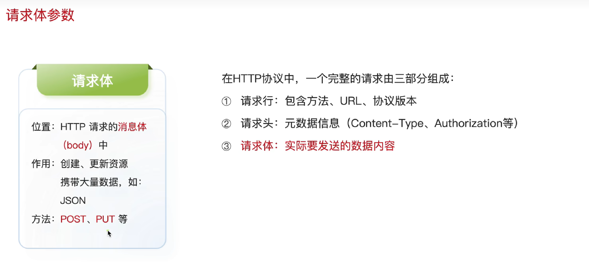

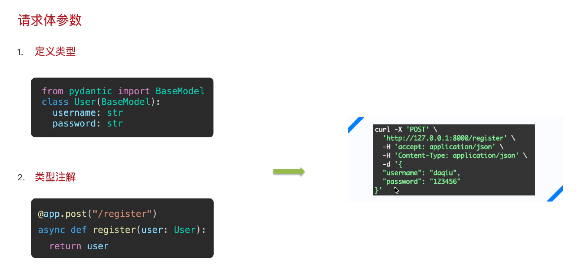

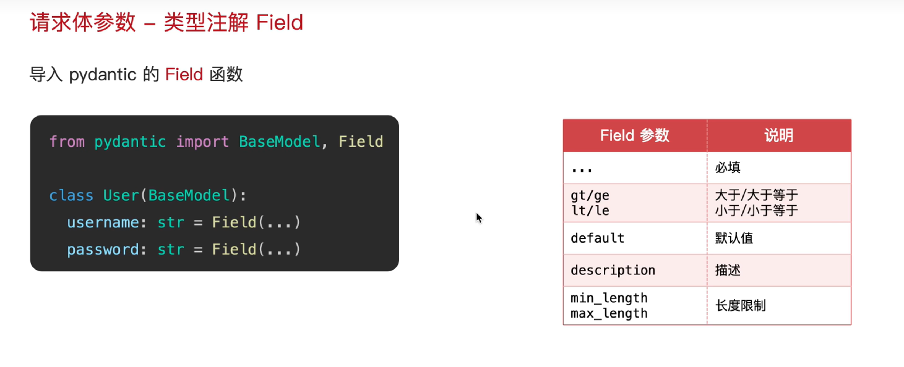

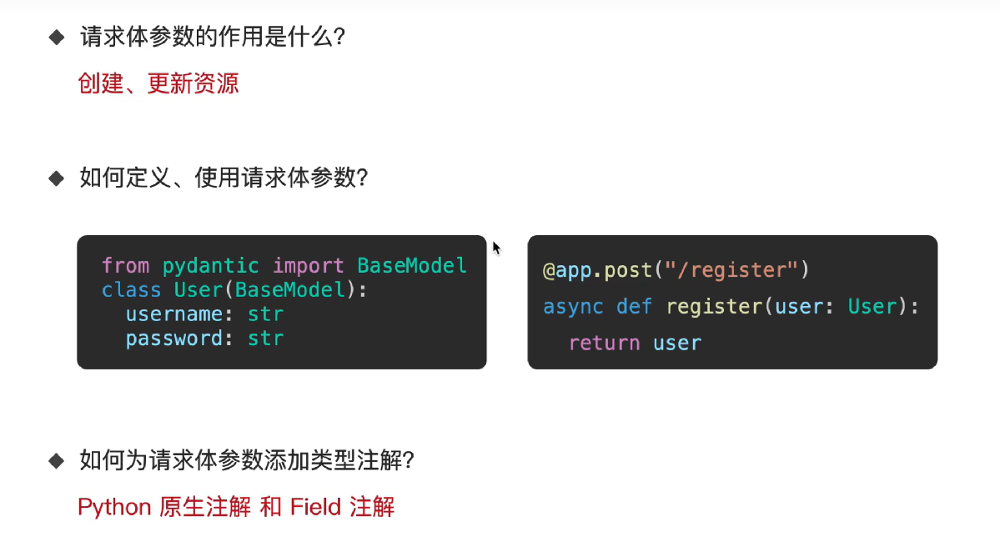

## 使用模型

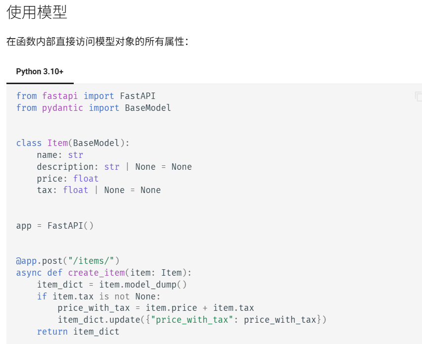

这部分主要想表达：**FastAPI 会把客户端提交的数据转换成 `Item` 模型对象，在函数内部，你可以通过 `item.price`、`item.tax` 这样的写法直接读取数据并进行计算。** 这正是文档中“直接访问模型对象的所有属性”的含义。[FastAPI 官方文档](https://fastapi.tiangolo.com/zh/tutorial/body/#use-the-model)

这里的“模型”是**定义数据结构和校验规则的 Python 类**。这个例子定义商品数据，然后在收到请求时计算含税价格。

### 代码解释

整个过程可以理解为：

```
客户端发送 JSON
      ↓
FastAPI 根据 Item 校验数据，创建 item 对象
      ↓
函数读取 item.price、item.tax 等属性
      ↓
如果有税额，就计算含税价格
      ↓
返回结果，由 FastAPI 转成 JSON 响应
```

下面按代码顺序逐行解释。

**1. 导入 FastAPI**

```
from fastapi import FastAPI
```

从 `fastapi` 包中导入 `FastAPI` 类，用它创建 Web 应用。

**2. 导入 BaseModel**

```
from pydantic import BaseModel
```

从 `pydantic` 包中导入 `BaseModel`。

继承这个类后，你定义的模型就可以使用 Pydantic 提供的数据校验、类型转换和导出数据等功能。

**3. 定义商品模型**

```
class Item(BaseModel):
```

定义一个名为 `Item` 的类，继承 `BaseModel`。

下面缩进的四行用于声明：一个商品包含哪些字段，以及每个字段允许什么类型的数据。

**4. 商品名称**

```
    name: str
```

声明字段 `name`，类型是字符串。

这里没有默认值，所以它是**必填字段**。例如：

```
"name": "键盘"
```

`:` 在这里用于类型注解。

**5. 商品描述**

```
    description: str | None = None
```

这行分成两部分理解：

- `str | None`：值允许是字符串，也允许是 `None`。
- `= None`：默认值是 `None`，客户端可以不传这个字段。

因此下面三种情况都可以：

```
# 传入字符串
description = "机械键盘"

# 显式传入空值（在请求 JSON 中写 null）
description = None

# 不提供 description，则使用默认值 None
```

注意：**允许为空由 `| None` 表达；允许省略由默认值 `= None` 表达。**

**6. 商品价格**

```
    price: float
```

声明字段 `price`，类型是浮点数，例如 `100.0`。

它没有默认值，也是必填字段。

**7. 税额**

```
    tax: float | None = None
```

声明字段 `tax`：

- 可以是浮点数，也可以是 `None`。
- 可以省略，省略时默认是 `None`。

这里的 `tax` 表示**税额**，例如 `10.0` 元；从后面的加法可以看出，它不是税率。

四个字段的要求如下：

| 字段          | 类型            | 是否可以省略 | 省略后的值 |
| ------------- | --------------- | ------------ | ---------- |
| `name`        | 字符串          | 否           | 无默认值   |
| `description` | 字符串或 `None` | 是           | `None`     |
| `price`       | 浮点数          | 否           | 无默认值   |
| `tax`         | 浮点数或 `None` | 是           | `None`     |

**8. 创建应用**

```
app = FastAPI()
```

创建一个 FastAPI 应用对象，并赋值给变量 `app`。

接下来通过这个对象注册接口。

**9. 注册 POST 接口**

```
@app.post("/items/")
```

这是一个**装饰器**，把紧接着定义的函数注册为接口处理函数。

它告诉 FastAPI：

> 当收到发往 `/items/` 的 POST 请求时，调用下面这个函数。

例如：

```
POST /items/
```

**10. 定义处理请求的函数**

```
async def create_item(item: Item):
```

分别看：

- `async def`：定义异步函数。本例没有需要等待的操作，因此内部没有使用 `await`。
- `create_item`：函数名称。
- `item`：函数参数名称。
- `: Item`：声明参数的类型是前面定义的 `Item` 模型。

**这里的 `Item` 是类，`item` 是这个类的一个实例对象。**

在这个接口中，FastAPI 会根据 `item: Item`，从请求体读取数据，进行校验，并把构造好的对象传给函数。如果数据不符合模型要求，默认会返回校验错误。[请求体与模型参数](https://fastapi.tiangolo.com/zh/tutorial/body/)

例如客户端发送：

```
{
  "name": "键盘",
  "price": 100.0,
  "tax": 10.0
}
```

进入函数后，就可以这样读取数据：

```
item.name         # "键盘"
item.price        # 100.0
item.tax          # 10.0
item.description  # None，因为请求中没有提供
```

**11. 把模型对象转换为字典**

```
    item_dict = item.model_dump()
```

调用模型对象的 `model_dump()` 方法，将数据导出为 Python 字典，再赋值给 `item_dict`。

对于上面的请求，得到：

```
{
    "name": "键盘",
    "description": None,
    "price": 100.0,
    "tax": 10.0
}
```

注意两种访问方式：

```
item.price          # 模型对象：通过属性访问
item_dict["price"]  # 字典：通过键访问
```

**`model_dump()` 返回的是字典，不是 JSON 字符串。** 这里先转成字典，是为了方便后面添加 `price_with_tax` 字段。

**12. 判断税额是否为空**

```
    if item.tax is not None:
```

含义是：

> 如果税额不是 `None`，就执行下面缩进的代码。

为什么不直接写：

```
if item.tax:
```

因为税额可能是 `0.0`，它仍然是有效税额。但是：

```
bool(0.0)        # False
0.0 is not None  # True
```

所以 `is not None` 能准确区分“没有税额”和“税额为零”。

**13. 计算含税价格**

```
        price_with_tax = item.price + item.tax
```

读取模型对象中的价格和税额，相加后保存到变量 `price_with_tax`。

在当前例子中：

```
price_with_tax = 100.0 + 10.0
# 结果是 110.0
```

这一行正是“直接访问模型对象属性”的具体体现。

**14. 把含税价格添加到字典**

```
        item_dict.update({"price_with_tax": price_with_tax})
```

`update()` 用来把另一个字典中的键值对写入当前字典：键不存在就添加，存在就覆盖。

这里：

```
{"price_with_tax": price_with_tax}
```

- 左边的 `"price_with_tax"` 是字符串，作为字典的键。
- 右边的 `price_with_tax` 是变量，提供刚才计算出的数值。

本例也可以写成：

```
item_dict["price_with_tax"] = price_with_tax
```

执行后，字典多出：

```
"price_with_tax": 110.0
```

这一步修改的是 `item_dict` 字典，原来的 `item` 模型对象没有因此新增字段。

**15. 返回结果**

```
    return item_dict
```

把字典作为函数结果返回，FastAPI 会将它转换为 JSON 响应。

注意它的缩进与 `if` 相同，说明 **`return` 在 `if` 外面，无论是否有税额，都会返回结果。**

有税额时，上述请求得到：

```
{
  "name": "键盘",
  "description": null,
  "price": 100.0,
  "tax": 10.0,
  "price_with_tax": 110.0
}
```

如果请求中没有提供 `tax`，它默认是 `None`，计算部分就会跳过，返回：

```
{
  "name": "键盘",
  "description": null,
  "price": 100.0,
  "tax": null
}
```

Python 的 `None` 对应 JSON 中的 `null`。此外，虽然函数名叫 `create_item`，这段代码实际只处理并返回数据，尚未执行数据库保存操作。

## 前后端处理逻辑和装饰器作用

这里做的核心事情是：**定义一个后端 API 接口，让前端可以通过 POST 请求提交商品数据，后端处理后把结果返回给前端。**

你可以把它们的关系理解成：

```
前端 Ajax 发起 POST 请求
           ↓
后端根据请求方法和 URL 找到对应接口
           ↓
执行 create_item() 函数
           ↓
return 返回处理结果
           ↓
前端收到 JSON 响应
```

我们先把代码简化来看：

```
@app.post("/items/")
async def create_item(item: Item):
    item_dict = item.model_dump()
    return item_dict
```

### **1. `create_item` 函数有什么意义？**

它是**处理请求的函数**：定义后端收到请求后应该做什么。

例如，前端提交：

```
{
  "name": "键盘",
  "price": 100
}
```

FastAPI 会先把这些数据解析、校验并转换成 `Item` 对象，然后调用这个函数，把对象作为 `item` 参数传进去。

你可以在函数内部编写业务逻辑，比如：

```
async def create_item(item: Item):
    # 读取商品数据
    # 计算含税价格
    # 保存到数据库
    # 返回处理结果
```

不过，**截图中的代码只计算并返回数据，没有保存到数据库。** 函数叫 `create_item`，不意味着它自动具备“保存商品”的功能，具体做什么取决于函数体。

函数名也不决定接口地址。即使你把它改成：

```
@app.post("/items/")
async def handle_product(item: Item):
    return item
```

前端仍然请求 `/items/`。

### **2. `@app.post("/items/")` 装饰器要干什么？**

它负责**把“请求方法＋请求路径”与下面的函数关联起来**。

```
@app.post("/items/")
async def create_item(item: Item):
```

可以理解为向 FastAPI 登记一条规则：

> 如果有人通过 **POST** 方法请求 **`/items/`**，就调用 **`create_item`** 来处理。

对应关系是：

| 请求方法 | 请求路径  | 处理函数      |
| -------- | --------- | ------------- |
| POST     | `/items/` | `create_item` |

这里有一个关键区别：

- 应用加载这段代码时：装饰器**注册接口**。
- 后续收到匹配的请求时：FastAPI **调用函数处理请求**。

**`@app.post()` 本身不会向任何地方发送请求。**

如果没有装饰器，这只是一个普通的 Python 异步函数，FastAPI 不会因此知道要把 `/items/` 的请求交给它。

### **3. 这里 `return` 返回的是什么？**

截图最后写的是：

```
return item_dict
```

从 Python 的角度看，它返回的是一个**字典**，例如：

```
{
    "name": "键盘",
    "description": None,
    "price": 100.0,
    "tax": 10.0,
    "price_with_tax": 110.0
}
```

这个字典先交给 FastAPI，由 FastAPI 生成 HTTP 响应。前端最终收到的响应体是 JSON：

```
{
  "name": "键盘",
  "description": null,
  "price": 100.0,
  "tax": 10.0,
  "price_with_tax": 110.0
}
```

因此，这里有两个层次：

```
Python 函数 return 字典
           ↓ FastAPI 转换
HTTP 响应携带 JSON
           ↓
前端读取响应数据
```

它返回的是**本次请求的处理结果**。

### **4. 这里是在创建 API 文档吗？**

**这段代码主要是在定义一个可以实际调用的 API 接口。FastAPI 同时会根据接口定义自动生成文档。**

两者是：

| 内容               | 用途                                     |
| ------------------ | ---------------------------------------- |
| API 接口 `/items/` | 接收请求、执行函数、返回结果             |
| API 文档 `/docs`   | 展示有哪些接口、参数要求，并提供试用入口 |

例如，本地服务如果运行在 `http://127.0.0.1:8000`，默认可以访问：

```
http://127.0.0.1:8000/docs
```

文档会根据代码展示：

- 请求方法是 POST。
- 接口地址是 `/items/`。
- 请求体需要 `name`、`price` 等字段。
- 哪些字段必填、各字段是什么类型。

文档页面上的 “Try it out” 和 “Execute” 也可以向这个接口发送真实请求。[FastAPI 官方教程](https://fastapi.tiangolo.com/zh/tutorial/body/)

### **5. 前端 Ajax 的 POST 和这里的 POST 有什么区别？**

**它们指的是同一种 HTTP 请求方法，但分别位于请求的发送端和接收端。**

| 对比           | 前端 Ajax POST     | 后端 `@app.post()`                     |
| -------------- | ------------------ | -------------------------------------- |
| 所在位置       | 通常在浏览器中     | 后端服务器中                           |
| 作用           | **发送** POST 请求 | 注册用于**接收和处理** POST 请求的接口 |
| 数据方向       | 把数据发给后端     | 读取数据，处理后返回响应               |
| 是否主动发请求 | 是                 | 否                                     |

Ajax 是前端与服务器异步通信的一种方式，它既可以发送 POST，也可以发送 GET 等请求。POST 则是 HTTP 的一种请求方法。

例如，用现代前端常见的 `fetch` 来完成这次请求：

```
// 假设前端页面与接口位于同一个站点
const response = await fetch("/items/", {
  method: "POST",
  headers: {
    "Content-Type": "application/json"
  },
  body: JSON.stringify({
    name: "键盘",
    price: 100,
    tax: 10
  })
});

// 读取后端返回的 JSON
const result = await response.json();

console.log(result.price_with_tax); // 110
```

与它对应的后端是：

```
@app.post("/items/")
async def create_item(item: Item):
    item_dict = item.model_dump()

    if item.tax is not None:
        price_with_tax = item.price + item.tax
        item_dict.update({"price_with_tax": price_with_tax})

    return item_dict
```

这两段代码的配合关系是：

```
前端 fetch("/items/", method: "POST")
                  │
                  │ 发送 name、price、tax
                  ▼
后端 @app.post("/items/") 匹配请求
                  │
                  ▼
create_item(item) 处理数据
                  │
                  │ return item_dict
                  ▼
前端 response.json() 读取返回结果
```

## 请求体+路径参数

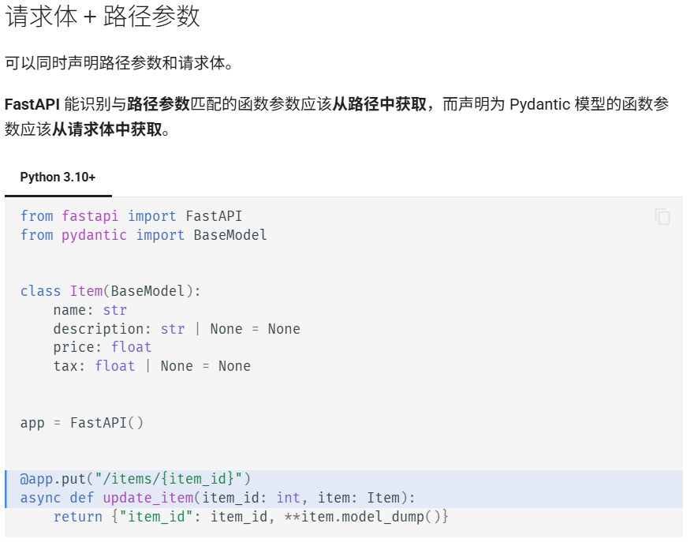

这部分想表达的是：**同一个接口可以同时接收 URL 路径中的参数，以及请求体中的数据。FastAPI 会根据函数参数的名称和类型，判断数据应该从哪里获取。**

比如，前端想修改 **编号为 123 的商品**：

- “修改哪个商品”通过路径 `/items/123` 表达。
- “商品的新数据是什么”通过请求体中的 JSON 表达。

对应的请求大致是：

```
PUT /items/123
Content-Type: application/json

{
  "name": "键盘",
  "price": 199.0
}
```

后端就会得到：

```
item_id = 123       # 从 URL 路径获取
item.name = "键盘"   # 从请求体获取
item.price = 199.0  # 从请求体获取
```

前面的 `Item` 模型与上一段代码相同，我们重点看最后三行。

### **1. `@app.put("/items/{item_id}")`**

```
@app.put("/items/{item_id}")
```

这行注册一个接口：

> 收到匹配 `/items/{item_id}` 的 PUT 请求时，调用下面的函数。

其中：

- `put`：接收 HTTP PUT 请求，通常用于更新指定资源。
- `/items/`：路径中固定的部分。
- `{item_id}`：路径中可变化的部分，名字叫 `item_id`。

例如：

| 请求路径     | 提取出的 `item_id` |
| ------------ | ------------------ |
| `/items/123` | `123`              |
| `/items/456` | `456`              |
| `/items/789` | `789`              |

**花括号表示占位符，前端发送请求时要替换成实际值。** 例如请求 `/items/123`。

另外，`put` 只是注册请求方法，**不会自动执行数据库更新**，更新逻辑需要你自己在函数中编写。

### **2. `async def update_item(item_id: int, item: Item):`**

```
async def update_item(item_id: int, item: Item):
```

定义处理请求的异步函数，它接收两个参数。

第一个参数：

```
item_id: int
```

因为参数名 `item_id` 与路径中的 `{item_id}` 一致，FastAPI 知道：

> 这个参数要从 URL 路径获取。

同时，`: int` 表示需要把提取到的内容解析、校验为整数。

例如请求：

```
/items/123
```

函数收到的是：

```
item_id = 123  # Python 整数，而不是字符串 "123"
```

如果请求 `/items/abc`，`abc` 无法解析为整数，默认会返回校验错误。

第二个参数：

```
item: Item
```

这里的 `Item` 是继承 `BaseModel` 的 Pydantic 模型，因此 FastAPI 知道：

> 这个参数要从请求体获取，并按照 Item 的定义校验。

例如请求体是：

```
{
  "name": "键盘",
  "price": 199.0
}
```

转换成模型对象后：

```
item.name         # "键盘"
item.price        # 199.0
item.description  # None
item.tax          # None
```

这就是截图中那句话的意思：**`item_id` 来自路径，`item` 来自请求体。** [FastAPI 官方说明](https://fastapi.tiangolo.com/zh/tutorial/body/#request-body-path-parameters)

注意，请求体直接放商品字段即可：

```
{
  "name": "键盘",
  "price": 199.0
}
```

按照这里的接口定义，不需要额外包一层 `"item"`。

### **3. `return {"item_id": item_id, \**item.model_dump()}`**

```
return {"item_id": item_id, **item.model_dump()}
```

这行把**路径里的商品编号**和**请求体里的商品数据**合并到一个字典中，然后返回。

拆开看就容易理解了。

首先：

```
item.model_dump()
```

把模型对象导出为字典：

```
{
    "name": "键盘",
    "description": None,
    "price": 199.0,
    "tax": None
}
```

然后：

```
**item.model_dump()
```

这里的 `**` 表示**把字典中的键值对展开，放进外层字典中**。

举个更小的例子：

```
data = {"name": "键盘", "price": 199.0}

result = {"item_id": 123, **data}
```

得到：

```
{
    "item_id": 123,
    "name": "键盘",
    "price": 199.0
}
```

所以，原来的返回语句也可以写成更容易看懂的三行：

```
result = {"item_id": item_id}
result.update(item.model_dump())
return result
```

FastAPI 最后将返回的字典转换成 JSON 响应：

```
{
  "item_id": 123,
  "name": "键盘",
  "description": null,
  "price": 199.0,
  "tax": null
}
```

### **4. 和前端请求对应起来**

前端可以这样调用，假设前端与 API 在同一个站点：

```
const itemId = 123;

const response = await fetch(`/items/${itemId}`, {
  method: "PUT",
  headers: {
    "Content-Type": "application/json"
  },
  body: JSON.stringify({
    name: "键盘",
    price: 199.0
  })
});

const result = await response.json();
console.log(result);
```

两边的数据对应关系是：

```
前端                              后端

/items/123                  →    item_id: int
                                 得到 123

body 中的商品 JSON          →    item: Item
                                 得到商品模型对象

response.json()             ←    return 返回的字典
                                 由 FastAPI 转成 JSON
```

这段示例实际演示的是**同时接收两处数据，再合并返回**。虽然函数名叫 `update_item`，但代码里还没有真正修改数据库中的商品。

## 解释 BaseModel、Field 和 Request Body 的作用

在 FastAPI 中，**`BaseModel` 是定义请求体数据结构的基类，`Field` 用于为模型字段添加精细的校验规则和元数据，而 Request Body 则是客户端发送给 API 的实际数据载体**。三者协作，共同实现了请求数据的结构化接收与自动校验。

### 📦 BaseModel：数据结构的蓝图

`BaseModel` 来自 Pydantic 库，你需要通过继承它来声明一个数据模型类，以此定义 API 期望接收的 JSON 对象结构。

- **定义字段与类型**：在类中声明属性及标准 Python 类型（如 `str`、`float`）。没有默认值的属性为必填项，有默认值的则为可选项。
- **自动校验与转换**：FastAPI 会依据该模型自动读取请求体 JSON，执行类型转换与校验。若数据无效，会返回清晰的错误信息。
- **提供编辑器支持**：在路径操作函数中，参数被标注为模型类型后，编辑器能提供属性自动补全和类型检查。

### 🏷️ Field：字段级的精细控制

`Field` 是 Pydantic 提供的函数（注意从 `pydantic` 导入，而非 `fastapi`），用于在模型内部为单个字段添加额外的校验规则和元数据。

- **添加校验约束**：例如 `gt=0` 限制数值必须大于 0，`max_length=300` 限制字符串最大长度。
- **声明元数据**：可以设置 `title`、`description` 等，这些信息会体现在自动生成的 OpenAPI 文档中，方便接口使用者理解。

### 📨 Request Body：数据的实际传输

Request Body 是客户端（如浏览器）通过 `POST`、`PUT` 等方法发送给 API 的数据。

- **声明方式**：在 FastAPI 中，只需将路径操作函数的参数类型标注为你的 `BaseModel` 子类，FastAPI 就会自动将该参数识别为请求体。
- **多参数处理**：如果函数中有多个 Pydantic 模型参数，FastAPI 会期望请求体是一个包含对应键的 JSON 对象（如 `{"item": {...}, "user": {...}}`），并自动将各部分分配给对应参数。

总结来说，**`BaseModel` 搭建结构**，**`Field` 细化规则**，二者共同定义了 Request Body 的“规范”；而 Request Body 则是符合该规范的实际数据。

#### request body是前端部分要发送的内容吗

是的，Request Body 确实是**前端（客户端）要发送给后端的内容**，但更准确地说，它是**HTTP 请求中携带的数据部分**，发送方可以是前端页面、移动 App、其他服务等任何客户端。

**具体来说**

**前端发送时**，Request Body 就是你在 `fetch` 或 `axios` 等请求中放在 `body` 里的数据，通常以 JSON 格式呈现。例如：

```javascript
fetch("/items/", {
  method: "POST",
  headers: { "Content-Type": "application/json" },
  body: JSON.stringify({ name: "foo", price: 12.5 })  // 这就是 Request Body
})
```

这里的 `{ name: "foo", price: 12.5 }` 就是前端构造并发送的 Request Body。

**后端接收时**，FastAPI 通过 `BaseModel` 子类来声明“我期望的 Request Body 长什么样”，然后自动解析前端发来的 JSON 并校验。

**需要注意的几点**

1. **不是所有请求都有 Body**：`GET`、`DELETE` 等请求通常不带 Body；`POST`、`PUT`、`PATCH` 才常用于携带 Body。
2. **Body 不一定是 JSON**：也可以是表单数据、文件上传、纯文本等，取决于 `Content-Type`。FastAPI 中声明为 Pydantic 模型时，默认对应 JSON。
3. **“前端”是宽泛说法**：严格讲是“客户端”。后端服务之间调用时，调用方同样会构造 Request Body，这时就没有“前端”了。

所以简单回答：**是的，Request Body 就是前端要发送的内容（请求体部分），它是前后端之间传递结构化数据的主要载体。**

## 为什么创建任务要用 POST，而不是 GET？为什么不能完全依靠前端检查数据是否正确？

这两个问题都涉及 Web 开发中的核心原则，分别从**HTTP 语义**和**安全边界**两个角度来理解。

---

### 一、为什么创建任务要用 POST 而不是 GET

#### 1. HTTP 方法的语义约定（幂等性与安全性）

HTTP 规范对方法有明确定义：

| 方法 | 安全（Safe） | 幂等（Idempotent） | 语义                             |
| ---- | ------------ | ------------------ | -------------------------------- |
| GET  | ✅ 是         | ✅ 是               | 获取资源，不应改变服务器状态     |
| POST | ❌ 否         | ❌ 否               | 提交数据，通常创建资源或触发处理 |

- **GET 被定义为"安全方法"**：调用它不应产生副作用。用 GET 创建任务，意味着"读一下"却改变了服务器状态，违反语义。
- **GET 是幂等的**：重复调用结果应相同。而创建任务每调用一次就多一条记录，天然不幂等——这正是 POST 的语义。

#### 2. 浏览器、代理、爬虫会"擅自"重发 GET

这是很实际的问题：

- 浏览器**预取（prefetch）**、**预渲染**会主动发起 GET 请求；
- 搜索引擎爬虫会抓取页面上的所有链接；
- 代理服务器、CDN 可能缓存并重放 GET；
- 用户刷新页面、点"后退"会重发 GET。

如果创建用 GET，这些行为会导致**意外创建大量重复任务**。POST 不会被预取、不会被缓存重放，相对安全。

#### 3. 参数暴露问题

GET 把参数放在 URL 里：

- 会出现在浏览器历史、服务器访问日志、Referer 头中；
- URL 长度有限制（各浏览器/服务器不同，通常几 KB），复杂任务数据放不下；
- 不适合传敏感或大量数据。

POST 把数据放在请求体里，更适合提交结构化、可能较大的数据。

#### 4. 缓存问题

GET 响应可能被浏览器或中间层缓存。创建操作的响应不该被缓存复用，POST 默认不缓存，更符合需求。

> **小结**：用 POST 创建任务，是遵循 HTTP 语义、避免意外副作用、保护数据、适配大数据量的综合结果。GET 适合"查询"，POST 适合"提交/变更"。

---

### 二、为什么不能完全依靠前端检查数据

核心一句话：**前端校验是"用户体验优化"，后端校验才是"安全边界"。前端代码运行在用户可控的环境里，不可信。**

#### 1. 前端代码完全在用户掌控之下

- 用户可以打开 DevTools 修改 JS、删掉校验逻辑；
- 可以用 Postman / curl 直接调接口，**绕过整个前端**；
- 可以改请求体任意字段。

前端校验拦得住"手滑的正常用户"，拦不住"有意为之的攻击者"，也拦不住任何直接调 API 的客户端。

#### 2. 攻击面不止浏览器

你的接口可能被：

- 移动 App、第三方集成、脚本程序调用；
- 自动化爬虫、恶意用户直接请求。

这些都不经过你的前端页面，前端校验形同虚设。

#### 3. 有些校验前端根本做不了

- **唯一性**：用户名/任务名是否重复，需要查数据库；
- **权限**：这个用户能不能创建/操作这个资源；
- **业务规则**：库存是否充足、状态机是否允许该转换、金额是否超限；
- **数据一致性**：关联的外键是否存在。

这些只有服务端掌握完整上下文才能判断。

#### 4. 安全类校验必须在后端

SQL 注入、XSS、越权访问、参数篡改（比如把价格改成 0.01）、批量赋值（mass assignment）等，前端无法防御，必须服务端做输入验证、参数化查询、权限检查。

#### 5. 前端校验仍有用——但定位不同

前端校验的价值在于：

- **即时反馈**，提升体验（不用等网络往返就知道格式错了）；
- **减少无效请求**，节省带宽和服务器压力；
- **引导用户**正确填写。

所以正确做法是**双层校验**：

```
前端校验：体验层，快速反馈、减少无效请求（可被绕过）
后端校验：安全层，最终权威、不可绕过（必须做）
```

后端永远假设"收到的数据可能是恶意的、不合规的"，做完整校验后再落库。

---

#### 总结

1. **创建用 POST**：因为 POST 非安全、非幂等，符合"提交/创建"语义；GET 会被预取、缓存、重放，且参数暴露在 URL，不适合有副作用的操作。
2. **不能只靠前端校验**：前端运行在用户可控环境，可被绕过、可被直接调 API 跳过；唯一性、权限、业务规则、安全防御只有服务端能做。前端校验是体验优化，后端校验是安全底线，二者缺一不可。

# 6.异常响应处理

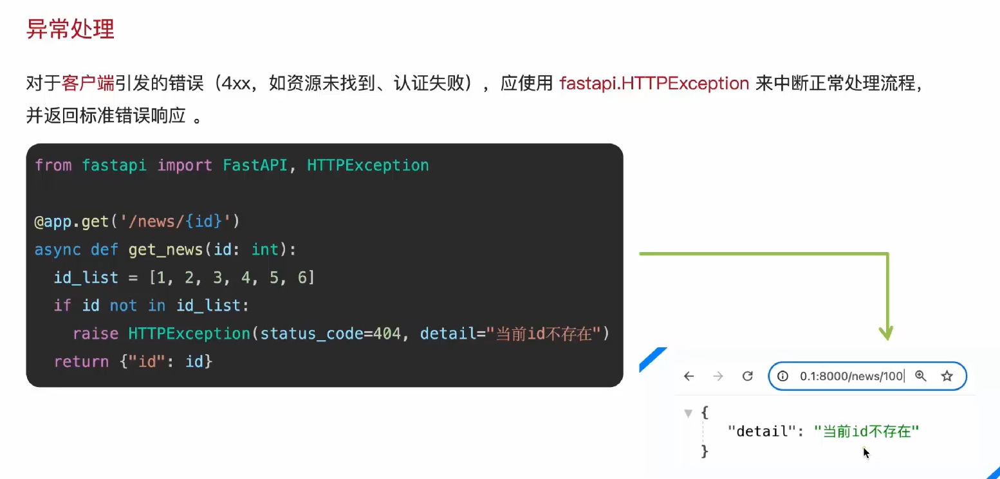

`status_code=201` 只是设置返回的状态码，**不会自动创建任务，也不会自动判断业务是否成功**；这些逻辑需要你自己编写。

在 Python 中，`raise` 语句的作用是**主动抛出一个异常**。

- 当程序执行到 `raise HTTPException(...)` 时，当前的函数会**立刻中断**。
- 它会直接跳出当前的执行流程，把异常抛给上层（在 FastAPI 中，就是交给框架的异常处理器去处理）。
- 因为函数已经中断了，所以位于 `raise` 后面的代码（包括 `return new_task`）**永远不可能被执行到**。

## 为什么查询不存在的任务应该返回 404，而不是返回空字典并声明成功？什么情况下应该让 Pydantic 自动产生 422？

因为**“请求的任务不存在”和“成功获取一个内容为空的任务”是两种不同的结果**，接口需要明确区分。

例如客户端请求：

```
GET /tasks/999
```

这表示“获取 ID 为 999 的那个任务”。如果不存在，却返回 `200` 和 `{}`，客户端会以为查询成功，还可能继续读取 `title`、`id` 等字段，结果出错。

返回 `404` 则能明确表达资源不存在，前端可以据此显示“任务不存在或已删除”：

```
raise HTTPException(status_code=404, detail="Task not found")
```

不过，**查询列表没有匹配结果时，通常返回 `200` 和空列表 `[]`**。例如 `GET /tasks?status=done` 没找到已完成的任务，仍然是一次成功的列表查询。

对于 `422`，应当让 Pydantic 和 FastAPI 自动处理**请求数据不符合声明的类型或约束**的情况：

| 情况                 | 声明示例                                    | 为什么返回 422 |
| -------------------- | ------------------------------------------- | -------------- |
| ID 传入 `abc`        | `task_id: int`                              | 无法转换为整数 |
| 标题传入 `""`        | `title: str = Field(min_length=1)`          | 长度不足       |
| 没传必填的标题       | 同上，无默认值                              | 缺少必填字段   |
| 状态传入 `"unknown"` | `Literal["pending", "in_progress", "done"]` | 不在允许的值中 |

严格来说，是 **Pydantic 执行数据校验，FastAPI 默认把请求校验错误转换为 HTTP `422` 响应**，通常无需自己捕获再抛出异常。

你的查询接口正好体现了这个先后顺序：

```
@app.get("/tasks/{task_id}")
def get_task(task_id: int):
    # 能进入这里，说明 task_id 已通过整数校验
    for task in tasks_db:
        if task["id"] == task_id:
            return task

    # ID 格式合法，但对应的任务不存在
    raise HTTPException(status_code=404, detail="Task not found")
```

- `/tasks/abc`：整数校验失败，**进入函数之前就返回 `422`**。
- `/tasks/999`：整数校验通过，但查不到任务，**由业务代码返回 `404`**。
- `/tasks/1`：整数校验通过且任务存在，**返回任务数据和 `200`**。

# 7.请求体:更新数据(PUT和PATCH)

## PUT使用

```python
from fastapi import FastAPI
from fastapi.encoders import jsonable_encoder
from pydantic import BaseModel

app = FastAPI()


class Item(BaseModel):
    name: str | None = None
    description: str | None = None
    price: float | None = None
    tax: float = 10.5
    tags: list[str] = []


items = {
    "foo": {"name": "Foo", "price": 50.2},
    "bar": {"name": "Bar", "description": "The bartenders", "price": 62, "tax": 20.2},
    "baz": {"name": "Baz", "description": None, "price": 50.2, "tax": 10.5, "tags": []},
}


@app.get("/items/{item_id}", response_model=Item)
async def read_item(item_id: str):
    return items[item_id]


@app.put("/items/{item_id}", response_model=Item)
async def update_item(item_id: str, item: Item):
    update_item_encoded = jsonable_encoder(item)
    items[item_id] = update_item_encoded
    return update_item_encoded
```

### 代码详解

这段代码实现了一个简单的商品接口：**通过 GET 查询商品，通过 PUT 用新的商品数据替换旧数据**。商品保存在 Python 字典里。

最需要注意的是：**更新时没有提交的字段，会使用 `Item` 模型中的默认值，并一起覆盖原来的数据。**

下面按代码的执行过程解释。

**① 导入模块并创建应用**

```
from fastapi import FastAPI
from fastapi.encoders import jsonable_encoder
from pydantic import BaseModel

app = FastAPI()
```

三个导入各有用途：

| 名称               | 作用                                             |
| ------------------ | ------------------------------------------------ |
| `FastAPI`          | 创建应用、注册接口                               |
| `BaseModel`        | 定义数据模型，校验数据类型并提供默认值           |
| `jsonable_encoder` | 把模型等对象转换成适合 JSON 序列化的 Python 数据 |

`app = FastAPI()` 创建应用，后面的 `@app.get()`、`@app.put()` 都是在这个应用上注册接口。

**② 定义商品的数据结构**

```
class Item(BaseModel):
    name: str | None = None
    description: str | None = None
    price: float | None = None
    tax: float = 10.5
    tags: list[str] = []
```

`Item` 继承 `BaseModel`，因此它除了保存数据，还能校验数据。

各个字段的含义如下：

| 字段          | 允许的类型      | 未提交时的默认值 |
| ------------- | --------------- | ---------------- |
| `name`        | 字符串或 `None` | `None`           |
| `description` | 字符串或 `None` | `None`           |
| `price`       | 浮点数或 `None` | `None`           |
| `tax`         | 浮点数          | `10.5`           |
| `tags`        | 字符串列表      | `[]`             |

例如：

```
name: str | None = None
```

可以拆成两部分理解：

- `str | None`：允许字段值是字符串，也允许是 `None`。
- `= None`：没有提供这个字段时，默认使用 `None`。

**“允许为空”和“允许不传”是两个概念。** 这里两者都允许。

而：

```
tax: float = 10.5
```

允许不传，不传就使用 `10.5`；但不允许显式传入 JSON 的 `null`，因为类型没有包含 `None`。

例如，客户端只提交：

```
{
  "name": "手机",
  "price": 2999
}
```

经过模型处理后，相当于：

```
Item(
    name="手机",
    description=None,
    price=2999.0,
    tax=10.5,
    tags=[],
)
```

因为所有字段都有默认值，所以提交空对象 `{}` 也能通过这个模型的校验。若传入 `"price": "abc"`，无法转换为浮点数，则 FastAPI 默认返回 `422`。[请求体官方文档](https://fastapi.tiangolo.com/tutorial/body/)

另外，`tags: list[str] = []` 在 Pydantic 模型中可以使用：Pydantic 会为实例复制这个可变默认值。也可以更明确地写成：

```
from pydantic import Field

tags: list[str] = Field(default_factory=list)
```

这表示为每个实例创建一个新的列表。[Pydantic 字段文档](https://pydantic.dev/docs/validation/2.12/concepts/fields/)

**③ 用字典模拟商品数据库**

```
items = {
    "foo": {"name": "Foo", "price": 50.2},
    "bar": {"name": "Bar", "description": "The bartenders", "price": 62, "tax": 20.2},
    "baz": {"name": "Baz", "description": None, "price": 50.2, "tax": 10.5, "tags": []},
}
```

这是一个嵌套字典：

- 外层的键 `"foo"`、`"bar"`、`"baz"` 是商品 ID。
- 外层的值是对应商品的数据。

例如：

```
items["foo"]
```

得到：

```
{"name": "Foo", "price": 50.2}
```

注意，**`items` 里的数据目前是普通字典，并不是 `Item` 实例**。定义这个字典时，不会因为前面存在 `Item` 类就自动校验或补齐字段。

这些数据只存在于当前进程的内存中，服务重启后会重新使用代码中的初始数据。

**④ GET 接口：根据路径参数读取商品**

```
@app.get("/items/{item_id}", response_model=Item)
async def read_item(item_id: str):
    return items[item_id]
```

假设请求：

```
GET /items/foo
```

执行过程是：

```
从路径获取 "foo"
       ↓
item_id = "foo"
       ↓
读取 items["foo"]
       ↓
按照 Item 模型处理返回数据
       ↓
向客户端发送 JSON 响应
```

这里：

```
item_id: str
```

声明 `item_id` 是字符串路径参数，所以可以接收 `"foo"` 这样的 ID。

而：

```
response_model=Item
```

声明**返回给客户端的数据应该符合 `Item` 模型**。FastAPI 会据此校验、序列化返回值，并在接口文档中描述响应结构。[响应模型官方文档](https://fastapi.tiangolo.com/tutorial/response-model/)

虽然原始数据只有：

```
{"name": "Foo", "price": 50.2}
```

但这个接口默认返回：

```
{
  "name": "Foo",
  "description": null,
  "price": 50.2,
  "tax": 10.5,
  "tags": []
}
```

这是因为缺失字段在响应模型处理时使用了默认值。Python 的 `None` 在 JSON 中表示为 `null`。

**响应中补齐了默认字段，不意味着 `items["foo"]` 本身被修改了。** 这个 GET 函数只读取数据，没有执行字典赋值。

`async def` 表示这是异步函数。这里的操作只是读取内存字典，不需要 `await`，也可以使用普通的 `def`。

**⑤ PUT 接口：接收要替换进去的数据**

```
@app.put("/items/{item_id}", response_model=Item)
async def update_item(item_id: str, item: Item):
```

这个函数的两个参数来自不同位置：

| 参数           | 来源        | 用途             |
| -------------- | ----------- | ---------------- |
| `item_id: str` | URL 路径    | 确定更新哪个商品 |
| `item: Item`   | JSON 请求体 | 提供新的商品数据 |

例如请求：

```
PUT /items/bar
Content-Type: application/json
```

请求体：

```
{
  "name": "新商品",
  "price": 100
}
```

FastAPI 会得到：

```
item_id = "bar"
```

以及一个经过校验和默认值填充的模型对象：

```
item = Item(
    name="新商品",
    description=None,
    price=100.0,
    tax=10.5,
    tags=[],
)
```

这里的 `item` 是 `Item` 实例，可以通过属性访问：

```
item.name
item.price
```

`item: Item` 负责声明输入数据，`response_model=Item` 负责声明输出数据。同一个模型在这里承担了两种作用。

**⑥ `jsonable_encoder(item)`：把模型转换成可序列化的数据**

```
update_item_encoded = jsonable_encoder(item)
```

在这个例子中，转换结果是一个普通 Python 字典：

```
{
    "name": "新商品",
    "description": None,
    "price": 100.0,
    "tax": 10.5,
    "tags": [],
}
```

**它返回的是字典，不是 JSON 字符串。**

可以这样区分：

```
# Python 字典
{"name": "新商品", "description": None}

# JSON 字符串
'{"name": "新商品", "description": null}'
```

`jsonable_encoder` 还可以处理 JSON 不直接支持的对象，例如将 `datetime` 转换为日期时间字符串。这里提前转换，是为了把模型数据以适合存储的形式放入 `items`。[编码器官方文档](https://fastapi.tiangolo.com/tutorial/encoder/)

**⑦ 字典赋值：真正执行整体替换**

```
items[item_id] = update_item_encoded
```

代入当前例子，就是：

```
items["bar"] = update_item_encoded
```

这行代码会把 `"bar"` 原来对应的整个字典替换掉。

更新前：

```
{
    "name": "Bar",
    "description": "The bartenders",
    "price": 62,
    "tax": 20.2,
}
```

客户端提交：

```
{
  "name": "新商品",
  "price": 100
}
```

更新后：

```
{
    "name": "新商品",
    "description": None,
    "price": 100.0,
    "tax": 10.5,
    "tags": [],
}
```

可以看到：

| 字段          | 原值               | 请求是否提供 | 更新后的值 |
| ------------- | ------------------ | ------------ | ---------- |
| `name`        | `"Bar"`            | 是           | `"新商品"` |
| `description` | `"The bartenders"` | 否           | `None`     |
| `price`       | `62`               | 是           | `100.0`    |
| `tax`         | `20.2`             | 否           | `10.5`     |
| `tags`        | 未存储             | 否           | `[]`       |

**未提交的字段不会保留旧值，而是采用新模型的默认值。** 这是这个示例展示的替换式更新行为。[更新请求体官方文档](https://fastapi.tiangolo.com/tutorial/body-updates/)

不过，实际执行替换的是字典赋值这行代码；仅仅写 app.put，FastAPI 并不会自动替你更新数据。

如果希望“只修改提交的字段，其他字段保持原样”，通常使用 `PATCH`，并通过：

```
item.model_dump(exclude_unset=True)
```

提取客户端显式提交的字段，再合并到旧数据中。

**⑧ 返回更新后的商品**

```
return update_item_encoded
```

返回的数据会经过 `response_model=Item` 处理，再发送给客户端。

这里没有指定 `status_code`，正常返回时默认是 `200`。响应体是更新后的商品：

```
{
  "name": "新商品",
  "description": null,
  "price": 100.0,
  "tax": 10.5,
  "tags": []
}
```

**这段示例还缺少你之前学习的“不存在时返回 404”的处理。**

GET 中：

```
return items[item_id]
```

如果键不存在，会抛出 Python 的 `KeyError`。默认情况下会导致服务器返回 `500`，不会自动变成 `404`。

PUT 中：

```
items[item_id] = update_item_encoded
```

如果键不存在，Python 会直接新增这个键，因此当前代码会创建一条新记录，并正常返回 `200`。

如果你要求“只能查询、更新已存在的商品”，就应在这两个接口中分别加入：

```
from fastapi import HTTPException

if item_id not in items:
    raise HTTPException(
        status_code=404,
        detail="Item not found",
    )
```

这样，请求数据类型不合法时由 FastAPI 返回 `422`；数据类型合法、但商品不存在时，由你的代码返回 `404`。

## 使用 Pydantic 的 `exclude_unset` 参数

```python
from fastapi import FastAPI
from fastapi.encoders import jsonable_encoder
from pydantic import BaseModel

app = FastAPI()


class Item(BaseModel):
    name: str | None = None
    description: str | None = None
    price: float | None = None
    tax: float = 10.5
    tags: list[str] = []


items = {
    "foo": {"name": "Foo", "price": 50.2},
    "bar": {"name": "Bar", "description": "The bartenders", "price": 62, "tax": 20.2},
    "baz": {"name": "Baz", "description": None, "price": 50.2, "tax": 10.5, "tags": []},
}


@app.get("/items/{item_id}", response_model=Item)
async def read_item(item_id: str):
    return items[item_id]


@app.patch("/items/{item_id}")
async def update_item(item_id: str, item: Item) -> Item:
    stored_item_data = items[item_id]
    stored_item_model = Item(**stored_item_data)
    update_data = item.model_dump(exclude_unset=True)
    updated_item = stored_item_model.model_copy(update=update_data)
    items[item_id] = jsonable_encoder(updated_item)
    return updated_item
```

### 代码详解

这段代码实现了**商品查询和局部更新**。与上一段 PUT 示例相比，核心区别是：

**客户端只提交想修改的字段，未提交的字段保留原值。**

例如请求：

```
PATCH /items/bar
Content-Type: application/json

{
  "price": 100
}
```

它只修改 `"bar"` 的价格，原来的名称、描述和税费都会保留。

我们沿着这个请求，逐行理解代码。

**① `Item`：定义商品的数据结构**

```
class Item(BaseModel):
    name: str | None = None
    description: str | None = None
    price: float | None = None
    tax: float = 10.5
    tags: list[str] = []
```

字段含义：

| 字段          | 允许的类型      | 未提供时的默认值 |
| ------------- | --------------- | ---------------- |
| `name`        | 字符串或 `None` | `None`           |
| `description` | 字符串或 `None` | `None`           |
| `price`       | 浮点数或 `None` | `None`           |
| `tax`         | 浮点数          | `10.5`           |
| `tags`        | 字符串列表      | `[]`             |

因为这些字段都有默认值，客户端可以只提交一部分字段：

```
{
  "price": 100
}
```

FastAPI 校验请求体后，会创建一个 `Item` 对象，相当于：

```
item = Item(price=100)
```

它的字段值是：

```
name = None
description = None
price = 100.0
tax = 10.5
tags = []
```

这里有一个关键点：**Pydantic 不仅保存字段值，还记录哪些字段是显式提供的。**

所以它知道：

```
item.model_fields_set
# {"price"}
```

虽然 `tax` 有值 `10.5`，但它来自默认值，并不是客户端提交的。这正是后面实现局部更新的基础。

**② `items`：保存现有商品**

```
items = {
    "foo": {"name": "Foo", "price": 50.2},
    "bar": {
        "name": "Bar",
        "description": "The bartenders",
        "price": 62,
        "tax": 20.2,
    },
    "baz": {
        "name": "Baz",
        "description": None,
        "price": 50.2,
        "tax": 10.5,
        "tags": [],
    },
}
```

这是用普通 Python 字典模拟数据库：

- `"bar"` 是商品 ID。
- `items["bar"]` 是该商品的数据。
- 数据保存在内存中，服务重启后会恢复成代码中的初始内容。

后续示例都以更新 `"bar"` 为例。

**③ GET 接口：读取某个商品**

```
@app.get("/items/{item_id}", response_model=Item)
async def read_item(item_id: str):
    return items[item_id]
```

请求：

```
GET /items/bar
```

就会执行：

```
return items["bar"]
```

`response_model=Item` 表示返回的数据按照 `Item` 模型处理。默认会在响应中补齐缺失字段，因此响应是：

```
{
  "name": "Bar",
  "description": "The bartenders",
  "price": 62.0,
  "tax": 20.2,
  "tags": []
}
```

这一步只是读取；响应中补齐 `tags` 不会自动修改原来的字典。

**④ PATCH 接口：区分路径参数、请求体和返回类型**

```
@app.patch("/items/{item_id}")
async def update_item(item_id: str, item: Item) -> Item:
```

这行包含三项声明：

| 写法           | 含义                                               |
| -------------- | -------------------------------------------------- |
| `item_id: str` | 从 URL 路径获取商品 ID                             |
| `item: Item`   | 将 JSON 请求体解析、校验成 `Item` 对象             |
| `-> Item`      | 声明返回类型，FastAPI 据此使用 `Item` 作为响应模型 |

所以在这个接口里：

```
@app.patch("/items/{item_id}")
async def update_item(...) -> Item:
```

与下面这种写法在响应模型方面作用相同：

```
@app.patch("/items/{item_id}", response_model=Item)
async def update_item(...):
```

`-> Item` 本来是 Python 的返回类型注解，FastAPI 会读取它来处理响应。普通 Python 函数不会仅因为写了类型注解就自动校验返回值。[响应模型文档](https://fastapi.tiangolo.com/tutorial/response-model/)

对于这次请求：

```
PATCH /items/bar
{"price": 100}
```

函数接收到的是：

```
item_id = "bar"
item = Item(price=100)
```

**⑤ 取出原来的商品数据**

```
stored_item_data = items[item_id]
```

相当于：

```
stored_item_data = items["bar"]
```

此时：

```
stored_item_data = {
    "name": "Bar",
    "description": "The bartenders",
    "price": 62,
    "tax": 20.2,
}
```

`stored_item_data` 是普通字典，保存的是更新前的数据。

**⑥ 把旧字典转换成 `Item` 模型**

```
stored_item_model = Item(**stored_item_data)
```

其中的 `**` 是**字典解包**：把字典中的键值对作为关键字参数传入。

因此上面这行相当于：

```
stored_item_model = Item(
    name="Bar",
    description="The bartenders",
    price=62,
    tax=20.2,
)
```

模型会校验旧数据，并补齐缺少的默认值：

```
stored_item_model = Item(
    name="Bar",
    description="The bartenders",
    price=62.0,
    tax=20.2,
    tags=[],
)
```

现在可以使用模型的方法，例如后面的 `model_copy()`。

注意，这里的税费保持为 `20.2`，因为旧数据明确提供了它，不会被默认值 `10.5` 替换。

**⑦ 提取客户端实际提交的字段**

```
update_data = item.model_dump(exclude_unset=True)
```

这是局部更新最关键的一行。

`model_dump()` 用于把模型转换成字典。

如果不加参数：

```
item.model_dump()
```

会得到全部字段，包括默认值：

```
{
    "name": None,
    "description": None,
    "price": 100.0,
    "tax": 10.5,
    "tags": [],
}
```

如果拿这些内容去覆盖旧数据，就会把名称改成 `None`、税费改成 `10.5`。

加上：

```
exclude_unset=True
```

表示：**排除没有被显式设置的字段。**

由于客户端只提交了 `price`，结果就是：

```
update_data = {
    "price": 100.0,
}
```

因此默认值不会意外覆盖旧数据。[局部更新官方文档](https://fastapi.tiangolo.com/tutorial/body-updates/)

这里要区分“没有传”和“明确传了空值”：

| 请求体                  | 提取的更新数据          | 更新效果           |
| ----------------------- | ----------------------- | ------------------ |
| `{"price": 100}`        | `{"price": 100.0}`      | 只修改价格         |
| `{"description": null}` | `{"description": None}` | 将描述设置为空     |
| `{"tax": 10.5}`         | `{"tax": 10.5}`         | 将税费改为 `10.5`  |
| `{"tags": []}`          | `{"tags": []}`          | 清空标签           |
| `{}`                    | `{}`                    | 不覆盖任何已有字段 |

**即使提交的值恰好等于默认值，也会保留在更新数据中。** `exclude_unset` 看的是“有没有显式提供”，不是“是否等于默认值”，也不是“是否为 `None`”。

**⑧ 复制旧模型，并覆盖需要更新的字段**

`model_copy(update=...)` 的作用是**基于原模型创建一个新的副本，并用 `update` 字典中的值覆盖或添加新副本的字段，而不会修改原始模型**。

```
updated_item = stored_item_model.model_copy(update=update_data)
```

可以理解为：

```
旧模型的全部字段
       +
客户端明确提交的新字段
       ↓
更新后的新模型
```

本例相当于：

```
updated_item = stored_item_model.model_copy(
    update={"price": 100.0}
)
```

得到：

```
Item(
    name="Bar",
    description="The bartenders",
    price=100.0,
    tax=20.2,
    tags=[],
)
```

只有 `price` 被覆盖，其他字段沿用旧模型的值。

`model_copy()` 返回一个新模型，不会直接把旧模型的 `price` 改掉。

还有一个技术细节：**`model_copy(update=...)` 不会重新校验传入的更新数据。** 这里的 `update_data` 来自已被请求模型校验过的 `item`；如果以后手动构造更新字典，不能指望 `model_copy()` 帮你检查类型。[Pydantic 模型文档](https://pydantic.dev/docs/validation/2.9/api/pydantic/base_model/)

**⑨ 转换为字典并保存**

```
items[item_id] = jsonable_encoder(updated_item)
```

这里分两步：

```
# 把 Item 模型转换为 JSON 可序列化的 Python 字典
encoded_item = jsonable_encoder(updated_item)

# 写回内存中的商品数据
items[item_id] = encoded_item
```

保存后的 `items["bar"]` 是：

```
{
    "name": "Bar",
    "description": "The bartenders",
    "price": 100.0,
    "tax": 20.2,
    "tags": [],
}
```

`jsonable_encoder()` 在这里返回字典，不是 JSON 字符串；对于日期时间等类型，它还会转换成适合 JSON 的值。[编码器文档](https://fastapi.tiangolo.com/tutorial/encoder/)

虽然最后也是替换整个字典，但**这个字典已经合并了旧数据和本次修改**，所以没有丢掉未提交字段的原值。

旧数据原本没有 `tags` 键，这次保存会把模型补齐的 `tags=[]` 一起写入。

**⑩ 返回更新后的完整商品**

```
return updated_item
```

返回的是 `Item` 模型对象，FastAPI 会根据 `-> Item` 处理成 JSON 响应。正常情况下状态码为 `200`：

```
{
  "name": "Bar",
  "description": "The bartenders",
  "price": 100.0,
  "tax": 20.2,
  "tags": []
}
```

**请求可以只包含一个字段，但响应返回的是更新后的完整商品。**

把更新函数加上注释，就是：

```
@app.patch("/items/{item_id}")
async def update_item(item_id: str, item: Item) -> Item:
    # 1. 读取旧数据：字典
    stored_item_data = items[item_id]

    # 2. 把旧字典转换成模型
    stored_item_model = Item(**stored_item_data)

    # 3. 只提取客户端明确提交的字段
    update_data = item.model_dump(exclude_unset=True)

    # 4. 复制旧模型，用新字段覆盖对应旧字段
    updated_item = stored_item_model.model_copy(update=update_data)

    # 5. 转换成可序列化的字典，保存更新结果
    items[item_id] = jsonable_encoder(updated_item)

    # 6. 返回完整的更新结果
    return updated_item
```

此外，这段代码仍然缺少商品不存在时的处理。GET 和 PATCH 都直接使用 `items[item_id]`，不存在时会抛出 `KeyError`，默认导致 `500`。应在读取前增加：

```
if item_id not in items:
    raise HTTPException(status_code=404, detail="Item not found")
```

并导入 `HTTPException`。这样才能实现你前面学习的行为：**商品不存在返回 `404`，请求字段类型不合法返回 `422`，更新成功返回 `200`。**

## DELETE使用

在 FastAPI 中，使用 **`@app.delete()` 定义删除接口**。通常通过路径参数指定要删除的资源：

```
DELETE /tasks/1
```

意思是：删除 ID 为 `1` 的任务。

接口的基本流程是：**查找任务 → 不存在则返回 404 → 存在则删除 → 返回成功响应**。

### **1. 一个完整示例**

沿用你之前使用的任务列表：

```
from fastapi import FastAPI, HTTPException, Response, status

app = FastAPI()

tasks_db = [
    {"id": 1, "title": "学习 FastAPI"},
    {"id": 2, "title": "练习 DELETE 接口"},
]


@app.delete(
    "/tasks/{task_id}",
    status_code=status.HTTP_204_NO_CONTENT,
)
def delete_task(task_id: int) -> Response:
    for index, task in enumerate(tasks_db):
        if task["id"] == task_id:
            del tasks_db[index]
            return Response(status_code=status.HTTP_204_NO_CONTENT)

    raise HTTPException(
        status_code=status.HTTP_404_NOT_FOUND,
        detail="Task not found",
    )
```

成功删除后返回 `204`，表示请求成功，**没有响应体**。[状态码官方文档](https://fastapi.tiangolo.com/tutorial/response-status-code/)

### **2. 逐行理解删除逻辑**

首先注册接口：

```
@app.delete(
    "/tasks/{task_id}",
    status_code=status.HTTP_204_NO_CONTENT,
)
```

- `@app.delete()`：这个接口处理 DELETE 请求。
- `/tasks/{task_id}`：通过路径参数确定要删除的任务。
- `status_code=204`：声明正常响应的状态码。

**装饰器只负责注册接口，不会自动删除数据。** 真正的删除操作由函数内部代码完成。

接着声明参数：

```
def delete_task(task_id: int) -> Response:
```

`task_id: int` 要求 ID 能解析为整数。

因此：

```
DELETE /tasks/abc
```

会在进入函数之前，由 FastAPI 默认返回 `422`。

`-> Response` 表示函数返回一个 HTTP 响应对象。

然后遍历列表：

```
for index, task in enumerate(tasks_db):
```

`enumerate()` 同时提供列表下标和元素：

| `index` | `task`                                   |
| ------- | ---------------------------------------- |
| `0`     | `{"id": 1, "title": "学习 FastAPI"}`     |
| `1`     | `{"id": 2, "title": "练习 DELETE 接口"}` |

**列表下标与任务 ID 是两个概念**，不能直接写 `del tasks_db[task_id]` 来删除对应 ID 的任务。

找到任务后：

```
if task["id"] == task_id:
    del tasks_db[index]
    return Response(status_code=status.HTTP_204_NO_CONTENT)
```

例如删除任务 `1`：

```
del tasks_db[0]
```

列表会变成：

```
[
    {"id": 2, "title": "练习 DELETE 接口"}
]
```

删除后立即 `return`，结束函数，不再继续遍历。

如果整个循环都没找到匹配任务，就会执行：

```
raise HTTPException(
    status_code=404,
    detail="Task not found",
)
```

客户端收到 `404` 和：

```
{
  "detail": "Task not found"
}
```

### **3. 删除成功应该返回 204 还是 200？**

两种方式都可以，取决于是否需要返回内容：

| 需求                         | 状态码 | 响应体      |
| ---------------------------- | ------ | ----------- |
| 删除成功，不需要返回数据     | `204`  | 无          |
| 删除成功，返回提示或删除结果 | `200`  | JSON 等内容 |

如果需要返回“删除成功”，可以改成：

```
@app.delete("/tasks/{task_id}", status_code=status.HTTP_200_OK)
def delete_task(task_id: int):
    for index, task in enumerate(tasks_db):
        if task["id"] == task_id:
            deleted_task = tasks_db.pop(index)
            return {
                "message": "任务删除成功",
                "task": deleted_task,
            }

    raise HTTPException(
        status_code=status.HTTP_404_NOT_FOUND,
        detail="Task not found",
    )
```

这里：

```
deleted_task = tasks_db.pop(index)
```

会**删除指定下标的元素，并返回被删除的元素**。

注意：上面是替代写法，不要同时注册两个相同路径的 DELETE 接口。使用 `204` 时，不应再返回 `{"message": "删除成功"}`，因为 `204` 不允许有响应体。

### **4. 如果数据保存在字典中**

你前面的商品示例使用的是字典，可以直接根据键删除：

```
@app.delete(
    "/items/{item_id}",
    status_code=status.HTTP_204_NO_CONTENT,
)
def delete_item(item_id: str) -> Response:
    if item_id not in items:
        raise HTTPException(
            status_code=404,
            detail="Item not found",
        )

    del items[item_id]
    return Response(status_code=204)
```

请求：

```
DELETE /items/foo
```

真正执行删除的是：

```
del items["foo"]
```

字典可以根据商品 ID 直接定位数据，因此不需要遍历列表。

### **5. 如何验证**

对于第一个返回 `204` 的任务示例，按顺序测试：

| 请求                   | 预期结果              |
| ---------------------- | --------------------- |
| `DELETE /tasks/1`      | `204`，任务被删除     |
| 再次 `DELETE /tasks/1` | `404`，任务已经不存在 |
| `DELETE /tasks/999`    | `404`，任务不存在     |
| `DELETE /tasks/abc`    | `422`，ID 类型不合法  |

可以在 FastAPI 的 `/docs` 页面测试，也可以发送：

```
curl -i -X DELETE http://127.0.0.1:8000/tasks/1
```

浏览器地址栏直接访问这个 URL，通常发送的是 GET 请求，无法用来调用 DELETE 接口。

## 1.`POST` 和 `PATCH` 在用途上有什么区别？为什么 `model_dump(exclude_unset=True)` 适合用于部分更新？如果未来 Agent 想执行 `update_task`，应该调用路由函数，还是优先复用业务函数？  

`POST` 常用于创建或触发操作，`PATCH` 用于部分修改；`exclude_unset=True` 能保留“只改传入字段”的意图；未来 Agent 执行 `update_task`，建议优先复用业务函数。

**① `POST` 和 `PATCH` 的用途**

| 方法    | 常见用途                 | 任务系统示例                            |
| ------- | ------------------------ | --------------------------------------- |
| `POST`  | 创建资源，或提交一个操作 | `POST /tasks` 创建任务                  |
| `PATCH` | 对资源进行部分修改       | `PATCH /tasks/123` 修改任务的标题或状态 |

例如，向 `PATCH /tasks/123` 发送：

```
{"status": "done"}
```

在按字段更新的接口约定下，表示只修改状态，标题和描述保持原样。`POST` 的语义更宽泛，并不局限于创建，例如也可以用 `POST /tasks/123/run` 触发执行。[HTTP 方法说明](https://developer.mozilla.org/en-US/docs/Web/HTTP/Reference/Methods)

**② 为什么 `model_dump(exclude_unset=True)` 适合部分更新？**

关键是区分：**“没传这个字段”和“明确把这个字段设为空”。**

```
from pydantic import BaseModel

class TaskUpdate(BaseModel):
    title: str | None = None
    description: str | None = None

patch = TaskUpdate(title="新标题")

patch.model_dump()
# {"title": "新标题", "description": None}

patch.model_dump(exclude_unset=True)
# {"title": "新标题"}
```

如果把普通 `model_dump()` 的结果全部写回数据库，原来的描述可能被默认值 `None` 覆盖。使用 `exclude_unset=True`，就能只拿到显式设置的字段，再仅更新这些字段。这也是 FastAPI 文档展示的部分更新方式。[FastAPI 更新指南](https://fastapi.tiangolo.com/tutorial/body-updates/)

它还会保留显式传入的空值：

```
TaskUpdate(description=None).model_dump(exclude_unset=True)
# {"description": None}
```

因此可以表达：

- 没传 `description`：保持不变。
- 传了 `description=None`：请求清空；是否允许由业务规则决定。

`exclude_none=True` 则会把显式传入的 `None` 也过滤掉，无法保留这种区别。同理，显式传入的 `False`、`0` 或默认值，也不该因为值本身而被忽略。[Pydantic 序列化说明](https://docs.pydantic.dev/latest/concepts/serialization/#excluding-and-including-fields-based-on-their-value)

**③ Agent 应该调用哪一层？**

建议让 HTTP 路由和 Agent 工具共同调用业务函数：

```
HTTP 请求 → 路由函数 ────┐
                       ├→ update_task 业务函数 → 数据库
Agent → 工具适配函数 ────┘
```

职责可以这样划分：

- **路由函数**：接收 HTTP 参数、获取调用者身份、转换响应和 HTTP 错误。
- **业务函数**：检查任务权限、校验更新规则、执行修改和保存。
- **Agent 工具适配函数**：校验工具参数、传入调用者身份、调用同一个业务函数。

这样两种入口执行相同的规则，也更容易测试。尤其要把权限检查放在共享调用路径中，避免 Agent 复用业务函数时绕过检查。

如果 Agent 在另一个服务中运行，可以通过 HTTP 调用 `PATCH` 接口；如果在同一应用内部，则优先调用业务函数。直接把路由函数当普通 Python 函数调用，会使业务复用依赖 HTTP 层，而且不会自动经过完整的请求处理流程。

## 2.jsonable_encoder和model_dump的区别

`jsonable_encoder` 和 `model_dump` 的核心区别在于：**`model_dump` 是 Pydantic 模型自带的方法，主要负责将模型实例转换为字典；而 `jsonable_encoder` 是 FastAPI 提供的通用工具函数，它会调用 `model_dump` 并进一步把结果中所有非 JSON 原生类型（如 `datetime`、`UUID`）递归转换为可 JSON 序列化的类型。**

### 核心区别对比

| 特性                     | `model_dump()`                                               | `jsonable_encoder()`                                   |
| :----------------------- | :----------------------------------------------------------- | :----------------------------------------------------- |
| **所属库**               | Pydantic                                                     | FastAPI                                                |
| **主要职责**             | 将模型转成 `dict`                                            | 将任意对象转成 **JSON 兼容**的 Python 结构             |
| **处理范围**             | 仅针对 Pydantic 模型（及嵌套模型）                           | 模型、字典、列表、`datetime`、`UUID`、`Decimal` 等     |
| **对非 JSON 类型的处理** | 默认保留原类型（如 `datetime` 对象），除非指定 `mode="json"` | 自动将其转为 JSON 安全类型（如 `datetime` 转为字符串） |
| **典型用途**             | 在代码内部处理数据、获取模型字段值                           | 直接构造 `JSONResponse`，或存入仅支持 JSON 的数据库    |

### 详细解析

#### 1. `model_dump` 的局限性
在 Pydantic V2 中，`.dict()` 已被重命名为 `.model_dump()`。它的默认行为是返回一个 Python 字典，但字典里的**值并不一定是 JSON 兼容的**。例如，模型里的 `datetime` 字段，经过 `model_dump` 后依然是 `datetime` 对象。如果你试图直接把这个字典塞进 `JSONResponse`，程序会报错，因为 Python 的标准 JSON 库不认识 `datetime`。

#### 2. `jsonable_encoder` 的补充作用
`jsonable_encoder` 正是为了解决上述问题而设计的。它的源码逻辑显示，当传入一个 Pydantic 模型时，它**内部会先调用 `model_dump`**，然后继续递归遍历结果，把 `datetime` 转成 ISO 格式字符串，把 `UUID` 转成字符串，把 `set` 转成 `list` 等等。FastAPI 在内部处理直接返回的 `JSONResponse` 时，用的就是这套逻辑。

#### 3. 性能考量
由于 `jsonable_encoder` 是一个通用的 Python 递归函数，它无法利用 Pydantic 底层的 Rust 编译器进行加速。在涉及大量数据序列化的“热路径”上，它的速度通常比直接使用 Pydantic 的 `model_dump_json()` 或 FastAPI 声明 `response_model` 要慢，因为它多了一层通用的类型判断与转换开销。

### 该如何选择
*   **如果你在编写 FastAPI 的路径操作函数**：尽量使用 `response_model` 或返回类型注解。FastAPI 会自动利用 Pydantic 的高性能序列化（Rust 侧）来生成 JSON，既快又安全，无需手动调用 `jsonable_encoder`。
*   **如果你需要手动构造 `JSONResponse`**：或者要把数据存入 MongoDB 这类 JSON 数据库，**必须**使用 `jsonable_encoder`，否则 `datetime` 等类型会导致序列化失败。
*   **如果你只是在代码里做数据处理**：比如想提取字段做逻辑判断，直接用 `model_dump()` 就够了，不需要引入 FastAPI 的编码器。

# 第一周全部代码

```python
from fastapi import FastAPI,Path,Query,status,HTTPException
from pydantic import BaseModel,Field
from typing import Literal

app=FastAPI()

@app.get("/")
def read_root():
    return {"message": "Hello, World!"}

@app.get("/hello/")
def read_hello():
    return {"message": "Hello from FastAPI!"}

# 路径参数
@app.get("/get_id/{user_id}")
def get_user_id(user_id:int=Path(...,ge=0,lt=101,description="用户只有100人")):
    return {"user_id": user_id,"message":f"Hello, user with ID {user_id}!"}

# 查询参数，查询新闻-》分页,skip:跳过的记录数,limit:返回的记录数10
@app.get("/new/news_list")
def get_news_list(
    skip:int=Query(0,lt=100,description="跳过的记录数"),
    limit:int=Query(10,ge=1,description="返回的记录数")
):
    return {"skip":skip,"limit":limit}

# 请求体参数，注册用户名和密码，类型注解
class User(BaseModel):
    username:str=Field(default="老虎",min_length=2,max_length=10,description="用户名")
    password:str=Field(min_length=6,max_length=20,description="密码")

@app.post("/register")
def register_user(user: User):  
    return user

# POST请求与pydantic数据模型
tasks_db=[]
class TaskCreate(BaseModel):
    title: str = Field(min_length=1)
    description: str = ""
    status: Literal[
        "pending", "in_progress", "done"
    ] = "pending"
@app.post("/tasks",status_code=status.HTTP_201_CREATED)
def create_task(task_data: TaskCreate):
    """
    - 实现 POST /tasks。
    - 客户端提交任务标题与描述。
    - 后端自动生成唯一的任务 ID。
    - 将新任务添加到内存列表中。
    - 返回创建成功的任务数据，建议状态码为 201。
    - 不允许客户端自己指定任务 ID。
    """
    # 内存示例使用整数 ID，首个任务为 1，之后依次递增。
    task_id = max((task["id"] for task in tasks_db), default=0) + 1
    
    # 构建完整的任务数据
    # 注意：我们基于客户端传入的 task_data 构建新字典，并强行加入由后端生成的 id
    # 这样即使客户端在 JSON 中恶意传了 id，也会被覆盖或忽略，满足“不允许客户端自己指定”的要求
    new_task = {
        "id": task_id,
        "title": task_data.title,
        "description": task_data.description,
        "status": task_data.status
    }
    
    # 将新任务添加到内存列表中
    tasks_db.append(new_task)
    # 返回创建成功的任务数据，FastAPI 会自动将状态码设置为 201 (我们在装饰器中已指定)
    return new_task

# 查询任务列表
@app.get("/tasks")
def get_tasks():
    """返回内存列表中的全部任务"""
    return tasks_db


# 异常响应处理
@app.get("/game/{game_id}")
def get_game(game_id: int):
    id_total=[1,2,3,4,5,6]
    if game_id not in id_total:
        raise HTTPException(status_code=status.HTTP_404_NOT_FOUND,detail=f"游戏ID {game_id} 不存在")
    return {"game_id":game_id}


# 第五天任务
@app.get("/tasks/{task_id}")
def get_task(task_id: int):
    """查询单个任务；非法 ID 类型由 FastAPI 自动返回 422。"""
    for task in tasks_db:
        if task["id"] == task_id:
            return task

    raise HTTPException(
        status_code=status.HTTP_404_NOT_FOUND,
        detail="Task not found",
    )

@app.delete("/books/{book_id}",status_code=status.HTTP_204_NO_CONTENT)
def delete_book(book_id:int):
    """
    - 实现 DELETE /books/{book_id}。
    - 根据 book_id 删除指定的书籍。
    - 如果书籍不存在，返回 404。
    - 如果删除成功，返回 204 No Content。
    """
    # 假设我们有一个内存列表 books_db 存储书籍信息
    books_db = [{"id": 1, "title": "Book One"}, {"id": 2, "title": "Book Two"}]
    
    for book in books_db:
        if book["id"] == book_id:
            books_db.remove(book)
            return  # 返回 204 No Content

    raise HTTPException(
        status_code=status.HTTP_404_NOT_FOUND,
        detail="Book not found",
    )
```

